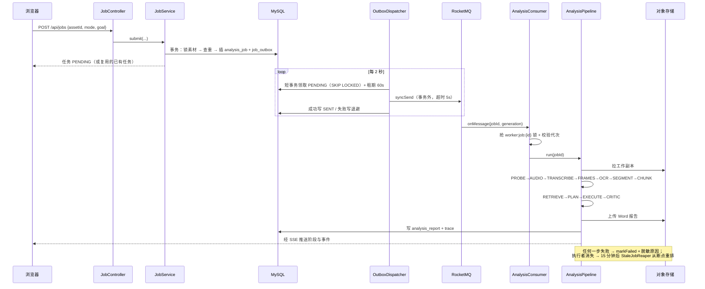

# 吃透 Video Studio：一份从「为什么」读到「怎么讲」的深度导读

> 这份文档不是接口手册。接口在 [API](api.md)，部署在 [部署说明](deployment.md)，结论性摘要
> 在 [架构](architecture.md)。这里回答的是另外三个问题：
>
> 1. **每个机制为什么长这样**——它替代了什么更简单但更糟的做法？
> 2. **它在代码里到底怎么跑**——从哪个方法进去，在哪一行做了决定？
> 3. **你要怎么把它讲出来**——面试、评审、交接时，一句话题眼是什么，追问怎么接？

---

## 0. 怎么用这份文档

按你的目的选一条路径，不必从头读到尾。

| 你的目的 | 读法 | 预计 |
|---|---|---|
| 明天要讲这个项目 | 第 1 节 → 第 4 节的七条主线（只读「一句话题眼」和「怎么讲」）→ 第 8 节问答 | 40 分钟 |
| 要改代码 / 加功能 | 第 2 节地图 → 第 3 节生命线 → 第 7 节代码地图 → 需要的那条主线 | 2 小时 |
| 要做 code review | 第 4 节七条主线全读 + 第 6 节数据模型 + 第 9 节已知短板 | 3 小时 |
| 完全不了解这个仓库 | 第 1 节 → 第 2 节 → 第 3 节，先建立骨架再钻细节 | 1 小时 |

一条通用建议：**先读第 3 节的一次任务生命线**。这个项目所有复杂机制，都是为了让那一条线在
异常情况下还能走完。看不懂机制，通常是因为没先看清它要保护的那条线。

---

## 1. 一页纸：它是什么，边界在哪

### 1.1 一句话

把一段几十分钟的视频（或纯音频）变成一份**每句话都能点回原片时间点**的结构化报告，
并允许你继续基于这些证据追问。

### 1.2 它真正解决的问题不是「总结」

视频总结这个需求，调一次大模型就能做出一个 demo。难的是三件事，这个项目的全部复杂度都花在这里：

1. **长**。两小时的视频塞不进任何模型的上下文窗口。必须先切、先检索、再组装。
2. **不可信**。模型非常擅长编造一句听起来很像的话，并配上一个看起来很像的时间戳。
   报告一旦有一条是编的，整份报告就失去价值。
3. **会坏**。一次分析要跑几分钟到几十分钟，中间要调 FFmpeg、调 ASR、调 OCR、调好几次大模型。
   任何一步都可能超时、失败、进程被杀。用户不能接受「转圈转到天荒地老」。

对应地，这个项目有三条设计主线，其余都是它们的推论：

- **证据链优先**：先有证据，再有结论；结论必须绑定证据；证据必须能在原片核验。
- **长上下文靠检索**：切块 → 建索引 → 按意图检索 → 组装成有预算的上下文。
- **任务必须可恢复**：任何一步失败，任务要么明确失败并留下原因，要么从断点继续。

### 1.3 它明确不做什么（这些「不做」同样是设计）

| 不做 | 为什么 |
|---|---|
| 不做降级兜底：没有 H2、没有内存向量库、没有离线模板、没有本地 Whisper | 兜底路径会让「看起来成功」的报告流出去。`config/ProductionRequirements.java` 在启动时就拒绝缺少 MySQL 或真实模型的配置 |
| 不做「换个措辞再试一次」式的重试 | 模型缺的是证据，不是措辞。第二轮补的是证据，不是提示词 |
| 不承诺外部模型「恰好一次」计费 | 消息是至少一次投递，进程可能在模型调用后、结果落库前退出 |
| 不做声纹身份识别 | 说话人分离是基于音高的近似标注，不是 biometric |
| 不用内存 pub/sub 推进度 | 事件以 `job_event` 表为准，Redis 只负责「叫醒」，丢一条消息最多退化成一次轮询 |

> **一句话题眼**：这是一个「证据优先」的长视频分析系统——所有机制都在保证报告里
> 每一条结论都能回到原片的某一秒，而不是保证报告写得好看。

---

## 2. 全局地图

### 2.1 模块与职责

后端 124 个 Java 文件、12,806 行，按职责切成 19 个子包（外加根包的 `VideoStudioApplication`）。记住这张表，找代码就不会迷路。

| 包 | 文件数 | 职责 | 入口类 |
|---|---|---|---|
| `web` | 9 | HTTP 接口、SSE、静态资源流 | `JobController`、`JobEventController` |
| `security` | 10 | 认证、授权、归属校验、令牌、管理端 | `SecurityConfig`、`OwnerGuard` |
| `service` | 7 | 用例编排：提交、重试、取消、清理、追问、证据复用 | `JobService`、`AnalysisPipeline` |
| `agent` | 9 | Planner/Executor/Critic、确定性校验、评测、上下文渲染、模式注册表、Agent 数据契约 | `AnalysisAgent`、`EvidenceValidator`、`AgentModels` |
| `retrieval` | 3 | 混合检索、向量库客户端 | `HybridRetriever`、`QdrantVectorStore` |
| `queue` | 5 | RocketMQ 消费、发件箱投递、僵尸任务回收 | `AnalysisConsumer`、`OutboxDispatcher`、`StaleJobReaper` |
| `media` | 12 | FFmpeg 探测/抽音/抽帧、去重、分片上传、链接导入 | `AudioExtractor`、`FrameExtractor` |
| `asr` | 5 | 云端语音识别、切片并发、说话人分离 | `TranscriptionService`、`SpeakerDiarizer` |
| `ocr` | 3 | 画面文字识别（默认调本地 Tesseract 命令）+ 帧去重后落库 | `CommandTextRecognizer`、`VisualEvidenceService` |
| `context` | 2 | 分块与摘要 | `ChunkBuilder`、`ChunkEnricher` |
| `llm` | 2 | 模型网关：chat / vision / embedding | `LlmGateway` |
| `domain` | 14 | 不可变模型：任务、阶段、模式、素材、证据 | `JobStage`、`AnalysisMode` |
| `repository` | 10 | Spring JDBC 持久化 | `JobRepository` 等 |
| `storage` | 3 | S3 对象存储 | `MinioObjectStore`、`MediaObjects` |
| `infra` | 8 | 指标、限流、预算、事件总线、TraceId | `JobMetrics`、`BudgetGuard` |
| `report` | 2 | Word 导出、字幕导出 | `DocxExporter`、`SubtitleWriter` |
| `webhook` | 1 | 终态回调 + HMAC 签名 | `WebhookService` |
| `config` | 10 | 配置属性、启动自检、Web 配置 | `ProductionRequirements` |
| `common` | 8 | JSON、时间、文本、脱敏、SQL 小工具 | `Secrets`、`Texts` |

前端 `client/src` 4,966 行：`App.vue`（1,018 行，单页外壳与五个标签页）、`SessionShell.vue`
（登录壳）、`api.js`（273 行，全部请求封装）、5 个展示组件、3 个纯函数单测 + 1 套 Playwright 浏览器测试。

### 2.2 一次请求从哪进

```
浏览器 ──HTTPS──> Spring Security 过滤器链
                     │ ① Cookie 会话 / ② Authorization: Bearer 令牌
                     ↓
                 OwnerGuard（HandlerInterceptor）
                     │ 路径匹配 ^/api/(media|jobs)/(\d+) 就查一次 owner_id
                     ↓
                 Controller ──> Service ──> Repository / Pipeline
                     ↓
               ApiResponse<T>（统一信封）
```

三个易错点，先记住：

- **principal 是字符串形式的用户 id**，不是用户名。`UserDetailsService` 用 `Long.toString(rs.getLong("id"))`
  构造 `User`，所以 `CurrentUser.id()` 可以直接 `Long.parseLong(auth.getName())`。会话认证和
  API 令牌认证都把 principal 设成 user id，**这样两条入口共用同一套授权逻辑**。
- **`OwnerGuard` 是按 URL 正则拦的**，所以任何形如 `/api/jobs/{数字}/...` 的接口自动受保护，
  新加接口不会忘记鉴权——这是刻意的「默认安全」。
- **`runtime()` 必须包 `ApiResponse`**。曾经它返回裸 `Map`，前端统一取 `payload.data`，
  结果整块环境信息变成 `undefined`，界面永远显示「离线模式」。见
  `web/JobEventController.java:182`。

---

## 3. 一次任务的完整生命线

这一节是全篇的骨架。**后面每一条主线，都是在保护这条线上的某一段。**

### 3.1 提交：三个不变量在同一个事务里成立

入口 `service/JobService.java:31` 的 `submit(assetId, mode, goal, title)`：

```
owner.media(assetId)                      ① 归属：不属于你的素材直接 404
requireBudget()                           ② 额度：全站日额度 + 当前用户日额度
decision = mode==null ? router.route(goal) : 用户指定   ③ 模式：自动判断或显式
focus = goal 为空 ? mode.defaultGoal() : goal
```

然后进入一段**刻意写得很挤**的事务：

```java
var token = redis.tryLock("submit:"+assetId+":"+digest(mode+":"+focus), ttl)   // ④ 提交幂等锁
try {
    transactions.execute(status -> {
        jdbc.queryForObject("SELECT id FROM media_asset WHERE id=? FOR UPDATE", Long.class, assetId);  // ⑤
        var active = jdbc.queryForList("... AND status IN ('PENDING','RUNNING') LIMIT 1", ...);         // ⑥
        if (!active.isEmpty()) return jobs.find(active.get(0)).orElseThrow();
        long id = jobs.insert(...);                                                                     // ⑦
        enqueue(id);                                                                                    // ⑧
        return jobs.find(id).orElseThrow();
    });
} finally { redis.unlock(key, token); }
```

为什么这么写：

- **⑤ 的 `FOR UPDATE` 锁的是素材行，不是任务行。** 同一素材上并发提交时，两个事务会在这里排队，
  于是 ⑥ 的「查重」才有意义。锁素材而不是锁任务，是因为「同一素材 + 同一模式 + 同一目标」才是
  幂等键，而这个组合属于素材。
- **⑥ 查重返回已有任务，而不是报错。** 用户双击提交按钮是常态，把第二次变成 409 是惩罚用户；
  返回第一次的结果才是他想要的。
- **⑦⑧ 必须在同一个事务。** 只写任务不写发件箱，任务会永远停在 PENDING 且没有任何消息来驱动它——
  发件箱轮询只扫 `job_outbox`，不会替你补记录。这条约束在回收器里同样成立（见 3.5）。
- **④ 的 Redis 锁在事务外，用 `finally` 释放。** 它是为了挡住「事务还没提交，第二个请求已经进来」
  的那几毫秒；真正的一致性靠 ⑤⑥。

> **题眼**：提交接口的幂等不是一个 `if`，是「Redis 锁挡瞬时并发 + 行锁串行化 + 状态查重」三层。

### 3.2 投递：发件箱的三段式

`analysis_job` 写完后，任务不会直接发 MQ，而是先落 `job_outbox` 一行（`enqueue`，
`service/JobService.java:90`）。真正的发送由 `queue/OutboxDispatcher.java:64` 每 2 秒跑一次。

**为什么要发件箱**：如果「写任务」和「发 MQ」是两个独立操作，中间挂掉就会出现
「任务在库里，但消息永远发不出去」——用户看到任务排队，实际没有任何 worker 会碰它。
把两件事放进一个本地事务，就把分布式问题降级成了本地问题。

**为什么要三段式而不是一个长事务**：`syncSend` 在 Broker 卡顿时会一直阻塞到超时（5 秒）。
一段里取 10 条，最坏持锁 50 秒，既挡住其它实例，也拖垮连接池。所以拆成：

```
┌─ 事务 A（毫秒级，两条 SQL）────────────────────────────┐
│ SELECT ... WHERE status='PENDING' AND next_attempt_at<=NOW(3) │
│        ORDER BY id LIMIT 10 FOR UPDATE SKIP LOCKED            │
│ UPDATE ... SET next_attempt_at = NOW(3) + 60 秒               │
└──────────────────────────────────────────────────────────────┘
              ↓ 提交，锁立刻释放
┌─ 事务外：syncSend（可能阻塞 5 秒）─────────────────────┐
│ 成功 → UPDATE status='SENT', sent_at=NOW(3)             │
│ 失败 → attempts+1，next_attempt_at = NOW(3) + 退避       │
└─────────────────────────────────────────────────────────┘
```

三个细节值得单独讲：

1. **`next_attempt_at` 被当作租约（lease），而不是新增一个 `SENDING` 状态。**
   因为「进程在领取后崩溃」这条路径必须自动恢复。用状态机的话，`SENDING` 是一个无主的中间态，
   需要另一个补偿器去扫；用租期的话，时间一过记录自然重新可领。少一个状态，少一个补偿器。
2. **租期从 `NOW()` 起算，不是旧值累加。** 进程重启后积压记录的 `next_attempt_at` 可能已经过去几分钟，
   加 60 秒仍在过去，其它实例会立刻再次领取，租约等于没生效。代码里这句注释是踩过坑的。
3. **退避是 `min(300, 1 << min(attempts+1, 8))` 秒，封顶 5 分钟。** 无上限的指数退避会让一次
   长时间 Broker 故障之后的恢复变得极慢。

**语义边界**：这是**至少一次**投递。发件箱标记 SENT 成功但数据库提交失败、或发送超时但消息其实到了，
都会导致重复投递。所以消费者必须幂等——幂等不是可选项，是这套设计的前提。

### 3.3 消费：四道闸门

`queue/AnalysisConsumer.java:27` 的 `onMessage` 依次做四件事，每一件都对应一条真实事故：

```
① 解析载荷：jobId <= 0 或 generation <= 0
     → recordInvalidMessage()：脱敏后写 failed_delivery（job_id 用 0 占位），然后确认
       （不抛错：这条消息不指向任何任务，重投一万次也还是非法消息，但必须留下痕迹）

② 抢锁：Redisson "worker:job:{id}"，tryLock(0, SECONDS)
     抢不到 → 直接 return（= 确认）
       （关键：不抛错。抛错会消耗重投次数，长任务的重复投递能把一条完全正常的消息推进死信）

③ 状态与代次：
     job == null / SUCCEEDED / CANCELED → return
     SELECT generation 与消息代次不符      → return
       （手动重试会 generation+1，旧代次消息不能重启一次已经重试过的分析）

④ 执行：pipeline.run(id)
     异常 → markFailed（已脱敏、已截断 300 字）
           → 若已是 CANCELED 则吞掉返回
           → getReconsumeTimes() >= 3 时 INSERT IGNORE INTO failed_delivery
           → 最后 throw，交给 RocketMQ 重投
```

注解上的三个数：`consumeThreadNumber = 2`（单实例并发两个任务，放开会让 ASR/OCR 的外部限流更难控）、
`maxReconsumeTimes = 3`、`consumeTimeout = 60`——**单位是分钟**，不是秒。

> **题眼**：消费者不是「收到就干活」，是「先证明自己该干、再证明没人正在干、再证明这是最新的活」。

### 3.4 执行：`AnalysisPipeline` 的 641 行

`service/AnalysisPipeline.java:252` 的 `run(jobId)` 是整条链的脊椎。它做的事情可以拆成五段：

```java
run(jobId):
  job/asset ← 查库
  source    ← objects.ensureSource(...)        从 S3 拉一份工作副本到本地临时目录
  run       ← new Run(job, asset, source)      内嵌类，持有 seq / 当前阶段 / 告警 / degraded
  metrics.jobStarted(mode)
  budget.begin/enter；MDC.put("jobId")
  markRunning
  try:
      execute(...)                              ← 真正的流水线
      if (!markSucceeded(jobId, run.degraded)) throw CancellationException("任务已取消")
      emit(DONE)
      checkpoints.save(jobId, DONE, ...)
  catch e:
      markFailed(jobId, Secrets.scrubOneLine(e.getMessage(), 300))
      emit(FAILED)
  finally:
      结算阶段耗时 → metrics.jobFinished → notifyWebhooks(...) → MDC.remove → budget.leave/end
```

`execute(...)`（`service/AnalysisPipeline.java:317`）里的阶段顺序，与 `domain/JobStage.java` 的
15 个枚举值一一对应。注意开头的这一句，它是整个断点续跑的地基：

```java
JobStage resumeFrom = checkpoints.find(run.jobId).filter(c -> c.stage() != DONE)...
run.attempts = checkpoints.find(run.jobId).map(JobCheckpoint::attempts).orElse(0) + 1;
```

**断点必须在任何 `stage()` 调用之前读。** `stage()` 自己会写断点，如果先调了 `stage(PROBE)`
再去读断点，新任务会被自己刚写的那条断点误判成「续跑」，从而跳过媒体探测。

阶段清单与它们的真实工作：

| 阶段 | floor | 实际动作 | 可跳过条件 |
|---|---|---|---|
| `PROBE` | 5 | `ffprobe` 读时长、分辨率、码率、音视频轨 | 否 |
| `AUDIO` | 15 | `ffmpeg -f segment` 按 60 秒切音频，`-reset_timestamps 1` 让每片从 0 开始 | 有可复用证据 |
| `TRANSCRIBE` | 30 | 切片并发调云端 ASR（线程池 `asr-N`，默认 3），按切片序收拢 | 有可复用证据 |
| `FRAMES` | 45 | 场景检测抽帧 + 兜底间隔 + 首帧 | 有可复用证据 |
| `OCR` | 55 | Tesseract 识别每帧文字 | 有可复用证据 |
| `SEGMENT` | 65 | 转写片段与画面证据对齐到同一时间轴 | 否 |
| `CHUNK` | 75 | 按 300 秒切窗，逐块摘要 + embedding | 有可复用分块 |
| `RETRIEVE` | 82 | 建 Qdrant 索引，然后 Agent 检索 | 索引失败只降级不改状态 |
| `PLAN` | 86 | Planner 拆任务 | 否 |
| `EXECUTE` | 92 | Executor 写结构化产物（有多轮） | 否 |
| `CRITIC` | 96 | 确定性校验 + 模型意见 | 否 |
| `REPORT` | 99 | 拼 Markdown、导出 Word、落 trace、写评测 | 否 |

两个刻意的「不失败」：

- **向量索引失败不终止任务**：`vectors.index(...)` 包在 try-catch 里，失败时
  `run.degraded = true` 并写一条 warn 事件。理由是分块与关键词已经在 MySQL，检索可以退化成
  纯词项匹配——**降级是可见的**（`degraded` 会写进任务和 trace），不是静默的。
- **语音和画面都为空才失败**：有一个就有得分析。两者皆空时抛
  「未能从该媒体中获得任何可用证据（语音与画面文字均为空），请检查文件内容或本地工具配置」。

### 3.5 回收：僵尸任务不会永远转圈

这条线最容易被忽略，却是「生产感」最强的一段。

**问题**：消费者死在半路（发布重启、OOM、机器宕机）。RocketMQ 的消息**已经被确认**了，
数据库里的状态却永远停在 `RUNNING`。这类任务既不能被重试接口接走（重试只接受 `FAILED`/`CANCELED`），
也不会再收到任何消息。前端只能一直转圈。

**`queue/StaleJobReaper.java:60` 的判定**：

```
SELECT id, generation FROM analysis_job
WHERE status='RUNNING' AND updated_at < NOW() - 15 分钟
ORDER BY updated_at LIMIT 20
    ↓ 对每一行
Redisson "worker:job:{id}" tryLock(0, 30 秒)
    ↓ 抢不到 → 跳过（worker 还活着，只是这一步很久没写进度）
    ↓ 抢到   → requeue(id, generation)
```

**为什么是「锁没人持有」而不是「更新时间太旧」**：正常执行时 Redisson 的看门狗会持续续期
`worker:job:<id>`。锁在，说明 worker 进程还活着——它可能正卡在一次 10 分钟的大模型调用里，
这时候把它拉起重跑，等于把已经花掉的钱再花一次。**两个条件同时成立**才回收。

**为什么直接抢锁而不是先 `isLocked()` 再改库**：那中间有一个窗口——检查时没锁，改库前 worker 刚好
抢到锁启动，于是同一任务被两个执行者同时跑。抢占成功本身就等价于「此刻没有 worker 在跑」，
一步解决竞态。代码注释写得很直白：*「直接抢锁，而不是先 isLocked() 再改库」*。

**回收动作是「重新排队」而不是「标记失败」**：任务自带断点，重跑会从最后一个完成的阶段继续，
不会把已经花掉的转写和抽帧再算一次钱。自动回收次数有上限（`generation > 3` 时改为置 `FAILED`
并写「执行者多次失联，已停止自动重跑；请检查日志后手动重试」），防止「一跑就崩」的任务无限烧钱。

**改状态与写发件箱必须在同一事务**（`queue/StaleJobReaper.java:97` 的 `requeue`）。理由和 3.1 一样：
只改状态不写发件箱，任务会永远停在 `PENDING` 而没有任何消息来驱动它。

### 3.6 生命线总览



---

## 4. 七条主线

下面每条主线都按同一个结构写：**问题 → 取舍 → 代码怎么落地 → 怎么讲**。
你可以只读「怎么讲」，但要能回答追问，得读前两段。

---

### 主线一：任务可靠性——为什么需要发件箱、代次、锁、回收器四件套

#### 问题

「提交任务 → 异步执行」看起来只要一个队列。但真实的故障是长尾的：

- 写库成功、发消息失败 → 任务永远排队
- 消息重复投递 → 同一任务被跑两遍，双倍花钱
- 消费进程被杀 → 任务永远 RUNNING
- 用户点重试，旧消息恰好迟到 → 两次执行互相覆盖

#### 取舍

一个朴素的方案是「任务表 + 定时扫表抢任务」。它简单，但有两个代价：扫表在高并发下会打满数据库；
而且它天然是**轮询**，最短延迟等于扫描间隔。用消息队列解决延迟，就必须额外解决「数据库和队列不一致」
——这正是事务发件箱要花的成本。

另一个选择是「用 MQ 事务消息」。RocketMQ 支持半消息 + 回查，但回查逻辑仍要你自己实现，
且要求 producer 能反查本地事务状态。发件箱把这件事摊在自己库里，更容易推理、更容易测。

**代价要说清楚**：至少一次投递意味着消费者必须幂等；发件箱表会增长，需要 SENT 记录的归档策略
（本项目目前没有做，见第 9 节）。

#### 代码落地

| 机制 | 位置 | 关键常量 |
|---|---|---|
| 同事务写任务 + 发件箱 | `service/JobService.java:31` 的 `submit`、`:90` 的 `enqueue` | — |
| 三段式投递 | `queue/OutboxDispatcher.java:64` 的 `dispatch`、`:82` 的 `claim` | `BATCH=10`、`LEASE_SECONDS=60`、`SEND_TIMEOUT_MS=5000` |
| 退避 | 同上 `throwOrMark` | `min(300, 1<<min(attempts+1,8))` 秒 |
| 消费互斥 + 代次 | `queue/AnalysisConsumer.java:27` | `consumeThreadNumber=2`、`maxReconsumeTimes=3`、`consumeTimeout=60`（分钟） |
| 僵尸回收 | `queue/StaleJobReaper.java:60`、`:97` | `worker.stale-minutes=15`、`max-automatic-requeue=3`、`interval=60000` |
| 代次递增 | `service/JobService.java:72` 的 `retryInternal` | `UPDATE ... generation=generation+1 WHERE status IN ('FAILED','CANCELED')` |
| 死信运维面 | `security/AdminDeliveryController.java` | `POST /api/admin/failed-deliveries/{id}/replay` |

一个容易被问到的细节：**重试是「递增代次 + 复用 jobId」，不是「新建任务」**。因为任务自带断点，
复用 jobId 才能续跑已完成的阶段；递增代次则保证旧消息即使迟到也启动不了新的执行。

#### 怎么讲

> 「我们把『把任务放进队列』这件事拆成了本地事务 + 发件箱轮询。投递分三段：毫秒级事务领取一批、
> 事务外发送、成功标记失败退避。用 `next_attempt_at` 当租约而不是新增 `SENDING` 状态，
> 这样进程领取后崩溃能自动恢复，不用再写一个补偿器。消费侧用 Redisson 锁 + 代次过滤挡重复，
> 抢不到锁直接 ack 而不是抛错——抛错会把一条正常消息推进死信。最后有个回收器，靠
> 『15 分钟没进度 **且** 锁没人持有』双条件识别僵尸任务，从断点重新排队。」

追问预备：

- *为什么不直接扫表？* —— 延迟和数据库压力。而且扫表抢任务仍然要解决「抢到之后崩溃」的问题，
  只是把并发控制从 MQ 换成了数据库。
- *至少一次会不会重复扣费？* —— 会。模型调用不是幂等的，所以明确不承诺恰好一次。
  报告不会重复，是因为写报告前会先 `DELETE FROM analysis_report WHERE job_id = ?`，
  同一个任务永远只有一份（`repository/ReportRepository.java:35`）。
- *Redis 挂了怎么办？* —— 要分开看。事件总线探测不到 Redis 时退化为纯进程内唤醒（跨实例推送失效，
  但 3 秒兜底轮询仍在，进度最多慢一点）；而 Redisson 客户端在启动时就连不上则会直接启动失败。
  这是有意的：**分布式锁不能有降级**，降级等于允许两个 worker 同时跑同一个任务。

---

### 主线二：Agent 编排——为什么否决权在确定性校验器手里

#### 问题

用大模型评审大模型，看起来能自动提高质量。实践里它会变成一台永动机：
每一轮都能挑出新的措辞问题，`passed` 永远是 `false`，任务永远结束不了，或者结束在一个已被
模型「认可」但事实错误的产物上。

#### 取舍

真正的质量分两类：

- **可判定的**：时间戳在不在素材范围内、证据原文能不能在转写里逐字找到、结论有没有绑定证据、
  必需小节有没有缺席。这些**不需要模型**，几行代码就能判，而且判得比模型准。
- **不可判定的**：措辞是否得体、推断是否越界、结构是否漂亮。这些只能让模型提意见，
  而且不可复现。

所以设计是：**确定性校验器有唯一否决权，模型 Critics 只贡献 feedback。**

#### 代码落地

`agent/AnalysisAgent.java:68` 的 `run` 主循环：

```java
deadline = now + max(30_000, maxDurationMs)          // 三重上限之一：墙钟
hits     = retriever.search(jobId, intent.query(), ...)
plan     = makePlan(...)
while (rounds < maxRounds && now < deadline) {        // 上限之二：轮次（默认 2）
    if (budget.exceeded(jobId)) throw "本任务模型预算已用尽"   // 上限之三：token 预算
    draft = execute(...)                               // Executor
    raw   = critique(...)                              // 模型 Critique + 确定性校验
    if (raw.passed()) break;
    // 关键：不是「把批评喂回去重写」，而是按缺口去全量证据里回捞
    recalled = recallByCritique(request, raw);
    extra    = retriever.search(jobId, critiqueQuery(goal, raw), ...);
}
if (critique == null || !critique.passed()) throw "分析未通过证据校验或已超时"
```

`critique(...)`（`agent/AnalysisAgent.java:232`）里那一行决定了整个语义：

```java
AgentModels.Critique merged = EvidenceValidator.merge(modelView, hard);
return hard.passed() ? EvidenceValidator.suggestions(merged) : merged;
```

`merge` 只把确定性校验的失败并回来；`suggestions` 把模型意见的 `passed` **强制置 true**。
所以主循环里 `raw.passed()` 读到的永远是**确定性校验的结果**，模型意见只出现在 `feedback` 里。
`agent/EvidenceValidator.java:196` 和 `:210` 就是这两个方法。

**为什么第二轮要「补证据」而不是「重写」**：校验失败的原因通常是模型手里没有回答这个问题所需的片段。
把同一份上下文再喂一遍，它只会换个说法编一次。所以第二轮做两件事：
按 Critic 给出的 `requiredTimestamps` 从**全量**证据里回捞（`ContextRenderer.recall`，
容差下限 `max(60_000, margin)` 毫秒），以及用「目标 + 反馈 + 缺失要求 + 无依据论断」拼一条新查询再检索一次。

**降级点设计得很克制**：模型 Critique 解析失败时重试一次，仍失败就当作 `Critique.pass()`。
理由写在注释里——*「Critic 只是建议角色，它自己的输出格式坏掉不该拖垮整个任务」*。反过来，
EvidenceValidator 永远不会「解析失败」，它判的就是结构化的草稿本身。

#### 怎么讲

> 「Agent 是 Planner / Executor / Critic 三角色，但**否决权不在 Critic 手里**。
> 模型的批评只用来决定『还值不值得再改一轮』，真正决定能不能发布的是确定性校验器：
> 时间戳在不在范围内、证据原文能不能逐字核验、每条结论有没有绑定证据。
> 主循环有三重上限——轮次、墙钟、token 预算，因为前两者防『跑太久』，只有 token 预算能防
> 『提示词写错导致无限循环』。第二轮补的是证据，不是措辞。」

追问预备：

- *为什么不让模型拍板？* —— 实测它每轮都能挑出新问题，把它当否决权会让正确报告永远出不来。
- *两轮够吗？* —— 默认 2 轮，可配。多轮收益递减明显，且每轮都是一次完整 Executor 调用。
- *确定性校验会不会误杀？* —— 会，比如 ASR 把数字听错。所以硬失败只保留四类
  （缺必需小节 / 空结论 / 来源不合法 / 全部证据无法核验），其余只记 `problems` 不否决。

---

### 主线三：证据链——为什么 ASR 和 OCR 必须塞进同一个块

#### 问题

证据链的目标是「报告里每一句都能回到原片某一秒」。实现它的难点不在校验，而在**喂给模型的上下文长什么样**。
如果上下文写成两节：

```
[语音转写]
[00:00-01:00] 这一页讲的是分层架构……

[画面文字]
[00:15] OCR: 三层：接入层 / 领域层 / 基础设施层
```

模型很容易写出「在 00:15 处提到分层架构」——它把整分钟的转写挂到了某一帧 OCR 的时间点上。
而 00:15 这一秒的转写原文里根本没有这句话。校验器会判它失败，但**这个失败是上下文结构造成的，
不是模型笨**。

#### 取舍

两种改法：一是放宽校验（不行，会放进编造的证据）；二是改上下文结构。

`agent/ContextRenderer.java:42`/`:49` 的 `render` 选择了后者：**把 ASR 片段与它时间窗内的
OCR/VISION 证据合并进同一个时间块**。

```
- [03:20 - 04:20] ASR（讲者A）: 我们这层的目标是让每个结论都能回溯……
    · [03:41] OCR: 证据链 = 原文 + 时间戳 + 来源
    · [03:58] VISION: 讲者在白板前指向架构图
```

模型看到的是一个时间块，写出来的 `timestampMs` 自然落在这个块的边界上，原文也自然来自块里的某一段。
校验就不再和上下文结构打架。

#### 代码落地

| 机制 | 位置 | 说明 |
|---|---|---|
| 分级预算 | `agent/ContextRenderer.java:49` | `budget = max(2000, round(maxContextChars * max(1.0, budgetScale)))`，概要用 `budget/3` |
| 逐条选入 | 同上 | 超预算时 `skipped++ ; continue`，**不是 break**。break 会让后面的块永远进不来；`continue` 让短块仍有机会补进来，并在结尾标注「另有 N 条因篇幅或条数上限省略」 |
| 块内合并 | 同上 | ASR 片段 + 窗口内 OCR/VISION |
| 定向回捞 | `agent/ContextRenderer.java:157` 的 `recall` | 按 Critic 给的 `requiredTimestamps` 从全量证据取，容差 `max(60_000, margin)` |
| 五类校验 | `agent/EvidenceValidator.java:98` | 缺小节 / 来源不合法 / 时间戳不存在 / 原文无法核验 / 结论无绑定 |
| 硬失败白名单 | `agent/EvidenceValidator.java:172-173` | `缺少必需小节`、`存在空结论`、`证据来源不合法` 前缀匹配，加「全部证据都无法核验」 |

`EvidenceValidator` 的判定本质上是**字符串包含**：把证据的 `content` 拿回到该时间点附近的
转写/OCR 原文里找。这也是为什么提示词里反复强调「逐字复制」——`prompts/executor.md` 写着：

> `timestampMs` 必须从 VideoContext 里逐字复制，不得自行估算或四舍五入。
> VideoContext 中每条证据前面都标了精确时间，例如「[00:15] OCR: ...」就写 15000；
> 不要写成 900、1000 这类看起来合理但上下文里没有的数字。

#### 怎么讲

> 「证据链的难点不在校验，在上下文结构。我们最初把语音和画面文字写成两节，模型会把某一帧的 OCR
> 文本挂到整分钟 ASR 的时间点上，校验必然失败。改成按时间块合并之后，模型写的时间戳和原文天然
> 落在同一个块里。校验器做五类检查，但硬失败只留四类——能判的才否决，判不了的不猜。」

追问预备：

- *为什么时间戳要逐字复制？* —— 校验是字符串包含，四舍五入就会失配。看起来严苛，其实是让
  「可核验」这个承诺可执行。
- *上下文超预算怎么办？* —— 逐条选入、跳过装不下的，不截断单条（截断会破坏原文，反而让校验失效）。
- *证据复用怎么保证一致？* —— 见主线七。

---

### 主线四：多模态证据生产——三个「必须这样做」的工程细节

这一节讲的是最容易在面试里被问穿的部分：**你说你处理了视频，那你到底怎么处理的？**

#### 4.1 抽帧：时间戳不能按序号推算

`media/FrameExtractor.java` 的滤镜链：

```
select='eq(n\,0) + gte(t-prev_selected_t\,<gap>) * (gt(scene\,<thr>) + gte(t-prev_selected_t\,<interval>))'
, scale='min(960\,iw)':-2, showinfo
```

拆开读：

- `eq(n,0)`：首帧必取。PPT 类视频开头就是标题页，漏掉很亏。
- `gt(scene, 0.006)`：场景切换点。阈值 0.006 很低是故意的——录屏和 PPT 的画面变化本来就小。
- `gte(t-prev_selected_t, <gap>)`：与上一帧至少间隔 `gap` 秒。**这一项同时起两个作用**：
  让场景点不挤成一串；并且天然把总帧数压在 `maxCount`（400）以内。
- `gte(t-prev_selected_t, 20)`：20 秒兜底。场景几乎不变的视频（纯口播）也能均匀采到帧。
- 最后 `-frames:v 400` 是硬上限。

**时间戳从哪来**：`showinfo` 输出 `pts_time:12.345`，正则 `pts_time:(\d+(?:\.\d+)?)` 提取。
**不按序号乘间隔**，因为镜头密度不均匀时序号和时间轴会越走越偏。

**两个踩过的坑，写在这里省你一次调试**：

1. `showinfo` 的输出打在 **stderr**，不是 stdout。只挂 stdout 回调会静默拿不到任何时间戳，
   然后退化成按序号推算——报告照常生成，只是所有时间点都是错的。
2. 阈值 `0.006` 如果被 `"%.2f"` 格式化成字符串，会变成 `"0.01"`，抽帧密度立刻变化。
   传参时必须用不带精度损失的形式。

**抽完还要去重，而且去重要两级**（`media/FrameDeduper` + `ocr/VisualEvidenceService`）：
PPT 停留、镜头静止会让同一屏被抽成几十帧，OCR 把同一段文字重复几十次，既污染检索也白烧上下文预算。

- 快筛：dHash（64 位，汉明距离 ≤ 5）+ 24×14 灰度签名（平均绝对差 < 1.2）。两级都要过才算同屏。
- 为什么不能只用 dHash：8×8 网格下，「整屏深色背景 + 中间一行标题」的四张不同幻灯片会算出同一个值。
- 文本判重：OCR 归并空白后与上一张保留帧完全相同，判定为同一屏，只保留第一次出现的时间点。

执行顺序是**串行算指纹 → 并行 OCR → 串行文本判重**：指纹是内存位运算（每帧几毫秒），OCR 是外部进程
（每帧几百毫秒），把重的并行、轻的判重保持串行，既不破坏「只和上一张保留帧比较」的语义，又能提速。

#### 4.2 语音：一次切完，并发识别，按序收拢

`media/AudioExtractor` 用一条命令切完所有音频片：

```
ffmpeg -f segment -segment_time 60 -reset_timestamps 1 -segment_list <csv> ...
```

`-reset_timestamps 1` 让每一片从 0 开始计时——云端 ASR 拿到的每一片都是独立的短音频，
不 reset 会出现「第二片从 60 秒开始」这种需要调用方补齐偏移的麻烦。偏移在合并时按切片序号补。

`asr/TranscriptionService` 用固定大小线程池（`asr-N`，默认 3）并发识别，**按切片顺序收拢**
再统一加偏移。并发度是配置项而不是硬编码，因为云端 ASR 通常有 QPS 限制。

#### 4.3 说话人分离：三个刻意的取舍

`asr/SpeakerDiarizer` 不做声纹识别，只做**基于音高的近似标注**。Javadoc 里写清了三个取舍：

| 取舍 | 理由 |
|---|---|
| 用**半音（semitone）**而不是赫兹 | 赫兹是线性尺度，男声 100→200Hz 和女声 200→400Hz 在赫兹上是同一个「差 100」，但听感差一个八度。半音是对数尺度，符合人耳 |
| 用**中位数**而不是均值 | 一句话里可能有清辅音、咳嗽、静音，均值会被拉偏；中位数对离群值稳健 |
| **只有一个说话人时不打标签** | 否则整篇都是 `Speaker 1`，噪音而且会误导下游的「按发言人组织」逻辑 |

聚类是一维层次聚类，阈值 `speaker-split-semitones=4.0`（约一个大三度）。

> 这一段是「你知道自己做了什么近似」的证明。面试里说「我们做了说话人分离」会被追问精度；
> 说「我们做的是基于 F0 中位数的近似标注，不是声纹识别，报告里会提示结合原片核对」，
> 追问就变成了加分项。

#### 4.4 视觉描述：默认关闭的成本开关

`ai.vision-caption-enabled` 默认 `false`。理由写在 `config/AiProperties.java`：

> 视觉模型按帧计费，长视频几百帧全量调用成本不可控。打开后也只补 OCR 文字极少的帧，
> 且单任务最多 24 帧。

这是「有能力的代码，但默认不烧钱」的典型例子——功能在，开关关上。

#### 怎么讲

> 「抽帧是首帧 + 场景切换 + 20 秒兜底的组合，时间戳取 ffmpeg 的 `showinfo` 而不是按序号推算，
> 因为镜头密度不均时会越走越偏。语音按 60 秒切片、reset 时间戳后并发识别再按序补偏移。
> 说话人分离是基于 F0 中位数的近似聚类，用半音是因为赫兹尺度不符合听感，用中位数是为了抗离群值；
> 只有一个说话人时不打标签。视觉描述默认关闭，按帧计费的东西不该默认打开。」

---

### 主线五：检索——混合权重与「不许自动删集合」的纪律

#### 问题

长视频的上下文装不下，必须检索。纯语义检索在专有名词、数字、代码标识符上很容易漏；
纯关键词又抓不住同义表达。

#### 取舍

`retrieval/HybridRetriever.java` 用固定权重线性组合：

```
score = 0.60 * 语义相似度 + 0.25 * 关键词命中 + 0.15 * 画面文字命中
```

权重与参考实现保持一致，注释写明了理由：*「纯语义在专有名词、数字上容易漏，纯关键词又抓不住同义表达，
混合后两者互补。」*

**一个刻意的取舍**：这里到 **chunk 级**就停了，`Hit` 携带整个 chunk 的 segments 和 evidences。
参考项目做得更细——chunk 粗排之后，再对 chunk 内的 segment 做一次细排（`0.55*chunkScore + 0.25*转写分 + 0.20*画面分`），
返回 segment 级命中。本项目没有做这一层，是已知差距之一（见第 9 节）。

#### 代码落地

| 机制 | 位置 | 说明 |
|---|---|---|
| 混合打分 | `retrieval/HybridRetriever.java` | `W_SEMANTIC=0.60 / W_KEYWORD=0.25 / W_VISUAL=0.15` |
| 余弦相似度 | 同上静态 `cosine` | 维度不一致或为零向量时返回 0，不抛异常 |
| 语义分降级 | 同上私有 `semanticScores` | 包 try-catch，异常时 `log.warn("语义检索不可用，本次按关键词匹配")` 返回空 Map |
| 集合初始化 | `retrieval/QdrantVectorStore.java:22` | 先 `GET /collections/<name>`，404 才 `PUT` 建；建完校验维度 |
| 维度不符 | 同上 | 抛 `IllegalStateException("Qdrant 向量维度不匹配，请迁移索引或更换集合；禁止自动删除现有集合")` |
| 点 id | 同上 `index` | `UUID.nameUUIDFromBytes(VectorStore.key(jobId, chunkIndex))` —— 同一任务同一分块重复索引是覆盖而非新增 |
| 批量写入 | 同上 | 每 64 条一批 `PUT /points?wait=true` |
| 索引缺失 | 同上 `semanticScores` | `scores.isEmpty() && !chunks.isEmpty()` 时抛，让上层降级 |

**「禁止自动删除现有集合」是一条纪律，不是一句注释。** 换 embedding 模型会改变向量维度，
自动删集合重建看起来「很贴心」，代价是**所有历史任务的追问能力瞬间消失且不可恢复**。
宁可在启动时崩掉，让人来决定是迁移还是新建集合。

**两处降级，粒度不同**：

- 索引**写**失败 → 任务继续，`degraded=true` + warn 事件（主线一的 3.4 节）。
- 索引**读**失败 → 本次按关键词匹配，不 500（追问是只读操作，没理由因为索引缺失就报错）。

#### 怎么讲

> 「混合检索，语义 0.6 / 关键词 0.25 / 画面文字 0.15。语义分拿不到就整条退化成关键词匹配，
> 因为追问是只读操作，不该因为索引抖动就 500。向量库这块有一条硬纪律：维度不匹配时拒绝启动，
> 不自动删集合——删了所有历史任务的追问能力就没了。点 id 用 jobId+chunkIndex 的确定性 UUID，
> 重复索引是覆盖而不是堆积。」

---

### 主线六：成本与安全——三层额度、两级归属、一次脱敏

#### 6.1 成本：三层额度，按任务反查归属

额度分三层：

```
单任务    budget.max-tokens-per-job          默认 2,000,000   Agent 循环里 exceeded(jobId) 检查
全站日    budget.max-tokens-per-day          默认 20,000,000  Redis 键，TTL 2 天
单用户日  budget.max-tokens-per-user-per-day 默认 5,000,000   Redis 键 + 按任务归属反查 owner
```

**难点在第三层**：消费线程里没有 `SecurityContext`，拿不到当前用户。
`infra/JobOwners` 按 jobId 反查 owner；查不到归属的历史数据只受全站额度约束。

为什么要做用户维度：只做全局额度，**一个人跑满全站当天额度，所有人都提交不了任务**。
反过来，超额只挡超额的这个人。

计费口径：`LlmGateway.exchange` 里优先读 `usage.total_tokens`，没有就读 `prompt + completion`，
两者都是 0 时用「请求体字节数 + 响应体字节数」粗估。**估不准也比不记好**——不记就等于额度失效。

#### 6.2 归属：principal 是用户 id

`security/OwnerGuard` 用一条正则拦所有 `/api/(media|jobs)/{数字}` 路径，各跑一条
`SELECT COUNT(*) ... owner_id = ?`。**不存在「忘了加鉴权」的新接口**——只要路径符合约定就自动受保护。

`security/ApiTokenFilter` 认证成功后，把 principal 设成**用户 id 字符串**（和会话认证一致），
然后 `finally` 里 `SecurityContextHolder.clearContext()`。两个细节：

- 一致 principal 意味着 `CurrentUser`、`OwnerGuard`、仓储归属过滤、按用户限流与预算**全部原样生效**，
  不需要为 API 调用开一条旁路。开旁路意味着每加一个入口都要重新检查一遍权限，漏一处就是越权。
- `clearContext()` 是必须的：线程池里的线程会被复用，不清理就等于把身份泄漏给下一个请求。

#### 6.3 令牌：为什么是 SHA-256 而不是 BCrypt

密码用 BCrypt(12)，令牌用 SHA-256。理由写在 `security/ApiTokenService` 的 Javadoc：

> 令牌是 32 字节高熵随机串，不是人选的密码，没有字典攻击面；而每次请求都要校验，
> BCrypt 的成本因子会让高频调用变慢。

存的是摘要，`prefix`（前 12 位字符）只是给人看「这是哪个令牌」。**创建时返回明文，之后再也取不回来。**

#### 6.4 脱敏：先抹掉再截断，顺序不能反

`common/Secrets` 有六类模式：`Bearer xxx`、`api_key=`/`token=`/`secret=`/`password=` 之类的命名参数、
`sk-` 前缀、`AKIA` 前缀、URL 查询参数里的签名、JSON 里的同名字段。

用在三个地方：任务失败原因（写 `analysis_job.error` 前，`scrubOneLine(msg, 300)`）、
告警详情（`scrubOneLine(detail, 200)`）、毒消息落库（`recordInvalidMessage`）。

**顺序不能反**：先截断会把 `Bearer sk-abc...` 切成 `Bearer sk-ab`，`sk-` 后要求至少 16 位，
正则就匹配不上了。所以永远是「先 scrub，后 truncate」。

为什么不直接不展示错误：`analysis_job.error` 会通过接口和 SSE 直接展示给用户，
不给原因的话所有失败都变成「未知错误」，运维和用户都无从下手。

#### 怎么讲

> 「成本做了三层隔离：单任务、全站每日、单用户每日。用户维度要按任务反查归属，因为消费线程里
> 没有 SecurityContext。安全上，API 令牌和会话认证都把 principal 设成用户 id 字符串，
> 这样所有归属校验和限流预算逻辑原样复用，不开旁路。错误信息先脱敏再截断，顺序反了正则就匹配不上。」

---

### 主线七：可观测与自愈——14 个指标、虚拟线程 SSE、断点、证据复用

#### 7.1 指标：只看会先坏的那几个

`infra/JobMetrics` 一共 14 个指标（前缀 `videostudio_`）：

| 类型 | 指标 | 什么时候看 |
|---|---|---|
| Gauge | `outbox_pending` | Broker 挂了会只增不减 |
| Gauge | `outbox_oldest_age_seconds` | 区分「瞬时抖动」和「链路已经断了」 |
| Gauge | `failed_delivery_total` | 死信积压 |
| Gauge | `jobs_active` / `jobs_over_budget` | 容量与成本 |
| Counter | `jobs_started/finished/requeued_total` | 恢复率 |
| Counter | `llm_tokens_total` | 成本 |
| Counter | `rate_limited_total` | 限流是否在误伤 |
| Timer | `job_duration_seconds` / `stage_duration_seconds` / `llm_call_duration_seconds` | 定位慢在哪一段 |
| Summary | `evidence_count` | 证据产出是否异常 |

`outbox_pending` + `outbox_oldest_age_seconds` 这一对是「会先坏」的信号：
Broker 不可用时 PENDING 只增不减，而最老记录年龄能告诉你是抖动还是断了。

`TraceIdFilter` 把 `X-Request-Id` 塞进 MDC；日志里带 traceId，一个请求的日志能串起来。

#### 7.2 SSE：为什么每个连接一个虚拟线程

`web/JobEventController.java:77` 的 `stream`：先回放历史事件（前端不用再拉一次），
再启动一个泵线程持续推新事件。

```java
Thread.ofVirtual().name("sse-pump-" + id).start(() -> {
    while (!closed.get()) {
        signal.tryAcquire(3, TimeUnit.SECONDS);   // 有信号立刻醒，没有最多等 3 秒
        signal.drainPermits();
        ...
    }
});
```

**为什么用事件表 + 轮询而不是内存 pub/sub**：刷新页面、断线重连都能从数据库补齐进度，
不会因为内存订阅丢失让前端卡在 90%。

**为什么每个连接一个虚拟线程**：泵线程大部分时间阻塞在 `tryAcquire` 上。用固定大小的平台线程池时，
「连接数 > 池大小」的其余连接会被饿住，事件要等到别人超时才能轮到自己。虚拟线程便宜到可以一人一个。

**唤醒机制**：`infra/JobEventBus` 本地 `wakeLocal` + Redis pub/sub 跨实例广播。
签名里那句注释很关键：*「这里只广播『有新事件了』这一个信号，因此丢一条消息最多退化成一次轮询，
不会丢数据。」* 3 秒的兜底轮询就是为这个设计的。

关闭是幂等的（`complete` / `timeout` / `error` 可能先后都触发），用 `AtomicBoolean disposed` 保证清理一次。

#### 7.3 断点：只记阶段，不记半次外部请求

`job_checkpoint` 表存 `(job_id, stage, payload_json, attempts)`。

`stage()` 每次切换阶段都会 `checkpoints.save`。续跑时从最后一个完成的阶段继续。
**不恢复半次外部模型请求**——模型调用没有幂等键，重放可能重复计费，所以断点的粒度就是阶段。

payload 里存的是「这一阶段产出的、下次还用得上的东西」，比如说话人分离标记。
这也是证据复用判定的来源（下一节）。

#### 7.4 证据复用：判据是「生成时开没开」，不是「有没有标签」

同一素材的第二个任务，不必重新转写和抽帧——这两步只取决于素材内容，与「用什么模式分析」无关。

但复用有前置条件：**这份证据必须和当前配置等价**。说话人分离开关就是一个维度。

一个想当然的判据是「转写里有没有 speaker 字段」。它错在：**单人素材本来就不该有标签**。
用这个判据，单人视频会每次都被判「需要重跑」，重复付 ASR 的钱。

正确判据是「**这份转写生成时有没有开分离**」，`service/EvidenceService.java:38` 的 `findReusable`：

```java
boolean separated = separatedSpeech(candidate.id());   // 读报告 trace 或断点 payload
if (!speech.isEmpty() && needsSpeakers() && !separated) {
    if (resumingSelf && hasSpeakerLabels(speech)) separated = true;  // 旧数据兜底
    else continue;                                                    // 跳过这个候选，重新识别
}
```

三个细节：

- 成功任务看**报告 trace** 的 `speakerSeparation` 标记。
- 断点续跑的任务还没有报告，标记随**断点 payload** 落库。
- 两处都读不到按**未标记**处理（宁可多跑一次），唯一例外是断点续跑遇到旧数据：
  转写确实带讲者标签，就认为分离过——旧版本不写标记，标签是唯一证据。

还有一条约束：返回的 `separated` 必须是「这份转写真的做过分离」，**不能因为开关关着就谎报 true**。

#### 怎么讲

> 「可观测性上我们盯的是『会先坏』的两个信号：发件箱积压量和最老记录年龄，它们能区分 Broker 抖动
> 和链路断掉。SSE 用事件表做真相源、Redis 只做唤醒信号，丢消息最多退化成一次轮询；
> 每个连接一个虚拟线程，因为泵线程大部分时间在阻塞等待，平台线程池会饿住多余的连接。
> 断点只记阶段不记半次模型请求。证据复用的判据是『生成时开没开说话人分离』而不是『有没有标签』，
> 因为单人素材本来就不该有标签。」

---

## 5. Agent 的数据契约

`agent/AgentModels` 里的六个 record 是模型和代码之间的契约。**它们全部不可变，全部在紧凑构造器里
把 null 兜成空列表**——因为模型返回的 JSON 里字段缺失是常态，让 null 流到下游会在很远的地方炸。

```java
Plan(String understoodGoal, List<String> tasks)                    // 1..5 个可验证任务
RetrievalIntent(String semanticQuery, List<String> keywords, List<String> visualKeywords)
Evidence(long timestampMs, String source, String content, String claim)
Section(String key, String title, List<String> items)
Draft(String title, List<String> conclusions, List<Evidence> evidence,
      List<String> suggestions, List<Section> sections)            // empty() = 无结论且无小节
Critique(boolean passed, List<String> feedback, List<String> missingRequirements,
         List<String> unsupportedClaims, List<Long> requiredTimestamps)
```

两个设计要点：

- **`Evidence.claim` 是「这条证据支持哪条结论」**，值必须**原样复制** `conclusions` 里的某一条。
  校验器就是靠这个字符串相等来判「结论有没有绑定证据」。如果模型改写了一个字，校验就会失败——
  这是刻意的：改写意味着它在做推断，而推断不该伪装成证据。
- **`Critique.requiredTimestamps` 是第二轮的输入**。它不是「建议再看一眼这些时间点」，
  而是「这些时间点上的原文请重新加载给我」。语义很具体，所以 `recall` 能直接照着做。

解析层 `agent/ContextRenderer.java` 的 `parse*` 方法用 `null` 表示失败（`parseModeReason` 例外，返回空串），由调用方决定重试还是放弃。
`parseDraft` 是唯一一个会记录诊断信息的——见主线二的 `logDraftFailure`：记录长度、是否疑似截断、
尾部 300 字。因为「模型未返回有效产物」这个错误太笼统，它既可能是被 `max_tokens` 截断
（要调配额），也可能是模型写了散文没写 JSON（要调提示词）。

**那个 4,096 的 token 上限是个好故事**：原来是 2,200，10 分钟视频的产物有十几条结论与证据，
会被截断成半个 JSON，无法解析，表现成「模型未返回有效产物」。**一个纯配额问题伪装成了模型故障。**

---

## 6. 数据模型：16 张表怎么读

按「谁产生、谁消费、能删吗」分组，比按字母序背表名有用得多。

### 6.1 核心四张（业务主链路）

| 表 | 主键 | 关键列 | 删除语义 |
|---|---|---|---|
| `media_asset` | id | `owner_id`、`storage_path`、`duration_ms`、`frame_dir` | 级联删任务、证据、对象前缀 |
| `analysis_job` | id | `status`、`stage`、`progress`、`generation`、`degraded`、`mode_source`、`mode_reason` | 删任务时清证据与报告 |
| `analysis_report` | id | `markdown`、`outline_json`、`trace_json`、`docx_path` | 跟任务走 |
| `job_event` | id | `job_id` + `seq`、`stage`、`type`、`level`、`payload_json` | **目前无保留策略**（见第 9 节） |

`analysis_job.generation` 是可靠性的核心列；`mode_source` 记录模式是 `AUTO` 还是 `USER` 选的，
`mode_reason` 存模型的判断理由——这两个让报告能解释「为什么用这个提纲」。

### 6.2 证据三张

| 表 | 主键 | 说明 |
|---|---|---|
| `transcript_segment` | id | `job_id + start_ms` 索引；`speaker` 是近似标注，可为空；`confidence` 可空 |
| `visual_evidence` | id | `time_ms`、`frame_path`、`ocr_text`、`caption`、`hash` |
| `context_chunk` | id | 300 秒窗口；`summary`、`keywords`、`visual_keywords`、`transcript_text`、`ocr_text`、`embedding` |

`context_chunk` 同时存了原文和 embedding，看起来冗余。理由是：**检索要用两个分数**。
语义分来自 embedding（或 Qdrant），关键词分直接在原文上算。只存 embedding 就没法算词项命中。

### 6.3 可靠性四张

| 表 | 唯一键 | 作用 |
|---|---|---|
| `job_outbox` | `UNIQUE (job_id, generation)` | 这个唯一键保证「同一代次只投一次」，重复入队是 `INSERT` 冲突而不是重复消息 |
| `job_checkpoint` | `job_id`（主键） | 一个任务只有一条断点，因为断点是「最新完成的阶段」而不是历史 |
| `failed_delivery` | `UNIQUE (message_id)` | 同一条消息不会重复记录；`replayed_at` 保证同一记录只能重投一次，防止反复点按钮放大费用 |
| `app_user` | `username` | `password_hash` 是 BCrypt-12 |

### 6.4 上传两张

`upload_session`（`upload_id` 主键，记 `total_chunks`、`received`）+
`upload_chunk`（复合主键 `(upload_id, chunk_index)`）。

为什么分片本身也要落库而不是只信内存计数：**进程重启后仍要能判断某一片是否真的写过**。
只信任内存计数，重启后 `received` 归零或错位，就会出现「看起来齐了、合并出来是坏的」。

### 6.5 对外开放两张

`api_token`（`token_hash CHAR(64) UNIQUE` + `prefix` + `last_used_at` + `revoked_at`）、
`webhook`（`url` + `secret` + `events` + `enabled`）。

Webhook 的三个刻意设计（`webhook/WebhookService` 的 Javadoc）：

- **异步**：独立线程池发送，接收方挂了不该让分析失败。
- **签名**：`X-VS-Signature: t=<ts>,v1=<hmac>`，HMAC-SHA256 对「时间戳 + 正文」签名，
  接收方按同样方式验签就能确认请求来自本服务。
- **不重试**：只发一次。重试需要持久化队列与幂等键，而 webhook 的语义本就是「尽力通知」；
  需要可靠送达的应该轮询任务接口。

---

## 7. 代码地图：按调用链读，不按目录读

第一次读这个仓库，**不要按包遍历**。按一条调用链走一遍，比看十个类的目录树有用。

### 7.1 只读一遍就能建立全貌的六个文件

| 顺序 | 文件 | 读它的目的 |
|---|---|---|
| 1 | `server/src/main/java/com/videostudio/domain/JobStage.java` | 15 个阶段 = 整条流水线的大纲 |
| 2 | `server/src/main/java/com/videostudio/service/AnalysisPipeline.java:252`（`run`）→ `:317`（`execute`） | 每个阶段实际在做什么 |
| 3 | `server/src/main/java/com/videostudio/agent/AnalysisAgent.java:68`（`run`） | Agent 主循环、三重上限、补证逻辑 |
| 4 | `server/src/main/java/com/videostudio/agent/EvidenceValidator.java:98`（`verify`） | 「可核验」到底怎么判 |
| 5 | `server/src/main/java/com/videostudio/agent/ContextRenderer.java:49`（`render`） | 模型看到的上下文长什么样 |
| 6 | `server/src/main/java/com/videostudio/queue/AnalysisConsumer.java:27` | 消息进来后被怎么对待 |

六个文件读完，你对这个系统的理解已经超过 90% 的人。

### 7.2 想改某个东西，该动哪里

| 你想改 | 去这里 | 注意 |
|---|---|---|
| 加一种分析模式 | `server/src/main/resources/modes.json` | **不用改 Java**。启动时校验 code 唯一、GENERAL 存在、guidance 非空 |
| 调提示词 | `server/src/main/resources/prompts/*.md` | 改完用 `DraftEvaluator` 的分数做前后对比（见 7.3） |
| 调检索权重 | `retrieval/HybridRetriever.java` 三个常量 | 改之前先想清楚是语义漏还是关键词漏 |
| 调上下文预算 | `application.properties` 的 `agent.max-context-chars` | 太大 token 费钱，太小学节缺失 |
| 加一个 REST 接口 | `web/` 下新建 Controller | 路径以 `/api/jobs/{id}` 或 `/api/media/{id}` 开头就自动受 `OwnerGuard` 保护 |
| 加一个指标 | `infra/JobMetrics` | 命名统一带 `videostudio_` 前缀 |
| 改抽帧密度 | `app.media.frame-*` | 阈值改动会显著影响成本 |
| 换 embedding 模型 | `EMBEDDING_DIMENSIONS` + `QDRANT_COLLECTION` | **会触发维度校验，必须新建集合**，不能复用 |

### 7.3 改提示词之后怎么验证

报告 trace 里有一段 `evaluation`，来自 `DraftEvaluator` + `EvaluationReport`：

```
score = 0.10 * timestampCoverage
      + 0.45 * evidenceSupport
      + 0.30 * claimSupport
      + 0.15 * keywordCoverage
```

权重不是随手定的。`timestampCoverage` 权重最低，理由写在 `EvaluationReport` 的 Javadoc 里：

> 它只说明时间点落在素材范围内，一条完全编造的证据只要时间戳随便落在某个片段里就能拿满分。
> 真正说明质量的是 evidenceSupport 与 claimSupport——文字能否对上原文。

**它不设阈值、不否决任务**，只把可比的数字留在 trace 里。`DraftEvaluator` 的 Javadoc 一句话说清了分工：

> 校验器回答「能不能发布」，评测回答「比上次好还是差」。

指标全部是确定性的、不调用模型——同样的输入必然得到同样的分数，所以能当回归基线长期保留。

---

## 8. 面试问答：20 个必答题

每题给「考点」和「一句话答法」。答法要能在一分钟内讲完，**先给结论，再给理由，最后给数字**。

### 8.1 架构与取舍

**Q1：介绍一下这个项目。**
考点：能不能三十秒讲清价值。答：把几十分钟的视频变成每句话都能点回原片时间点的结构化报告。
Java 21 + Spring Boot + Vue，MySQL/Redis/RocketMQ/S3/Qdrant。核心是证据链和任务可靠性。

**Q2：为什么要拆成这么多阶段？**
考点：是否理解长任务的失败代价。答：转写和抽帧是长视频里最贵的一步，阶段化让断点续跑有粒度，
也让进度能精确到百分比。15 个阶段的 floor 是给前端的进度条用的。

**Q3：为什么没有降级模式？别的项目都有 H2 / 内存向量库。**
考点：对「假成功」的判断。答：降级路径会让看起来成功但实际不可信的报告流出去。
`ProductionRequirements` 在启动时就拒绝缺少 MySQL 或真实模型的配置。唯一的降级是向量索引**写**失败，
而且它是**可见的**——`degraded` 会写进任务和 trace，并产生 warn 事件。

### 8.2 可靠性

**Q4：怎么保证任务不丢？**
考点：分布式一致性。答：事务发件箱。任务和发件箱记录在同一个本地事务里写，
后台轮询发送，发送失败保留记录并退避重试。

**Q5：发件箱为什么不用一个事务发完？**
考点：锁持有时间。答：`syncSend` 在 Broker 卡顿时阻塞到超时（5 秒），一次 10 条最坏持锁 50 秒，
既挡其它实例也拖垮连接池。所以拆成短事务领取 + 事务外发送 + 标记。

**Q6：进程领取后崩溃了怎么办？**
考点：中间态设计。答：不用 `SENDING` 状态，用 `next_attempt_at` 当租约。租期一过记录自动重新可领，
不需要额外的补偿器。租期从 `NOW()` 起算而不是旧值累加，否则积压记录会立刻被重新领取。

**Q7：消息重复投递怎么办？**
考点：幂等。答：两道。消费者按任务抢 Redisson 锁，抢不到直接 ack 不抛错（抛错会消耗重投次数）；
再用 generation 过滤掉旧代次消息。

**Q8：消费者死在半路，任务停在 RUNNING 怎么发现？**
考点：故障检测。答：`StaleJobReaper` 每 60 秒扫「RUNNING 且 15 分钟没更新」的任务，
然后**直接抢锁**——抢到才回收。两个条件缺一不可，因为锁在说明 worker 还活着（看门狗在续期），
它可能正卡在一次十分钟的模型调用里。

**Q9：为什么是抢锁而不是先 isLocked 再改库？**
考点：竞态窗口。答：先查后改中间有窗口，worker 可能刚好启动。抢占成功本身就等价于「此刻没有 worker」。
回收时「改状态」和「写发件箱」必须在同一个事务，否则任务停在 PENDING 而没有消息驱动。

### 8.3 Agent

**Q10：为什么不让大模型自己判断报告好不好？**
考点：可判定 vs 不可判定。答：实测模型每轮都能挑出新的措辞问题，把它当否决权会让正确报告永远出不来。
所以否决权在确定性校验器手里，模型意见只进 feedback。

**Q11：确定性校验具体判什么？**
考点：证据链落地。答：五类检查。硬失败只有四类：缺必需小节、空结论、证据来源不合法、
全部证据都无法核验。其余只记 problems 不否决。

**Q12：校验不过的下一轮做什么？**
考点：是否理解「缺的是证据不是措辞」。答：不是把批评喂回去重写。按 Critic 给的 `requiredTimestamps`
从全量证据里定向回捞，再用「目标 + 反馈 + 缺失要求 + 无依据论断」拼一条新查询重新检索，然后重写。

**Q13：Agent 会不会无限循环？**
考点：止损。答：三重上限——轮次（默认 2）、墙钟（默认 300 秒）、token 预算。
前两个防「跑太久」，只有 token 预算能防「提示词写错导致无限调用」。

**Q14：模型输出不是合法 JSON 怎么办？**
考点：容错分层。答：分角色。Planner 和 Executor 解析失败重试一次（Executor 只在首轮重试）；
Critic 解析失败重试一次，仍失败就当 `Critique.pass()`——它只是建议角色，格式坏掉不该拖垮任务。
另外 `max_tokens` 给到 4,096，2,200 会截断成半个 JSON，那是个纯配额问题伪装成模型故障。

### 8.4 多模态与检索

**Q15：视频怎么处理？**
考点：工程细节。答：FFmpeg 抽音频按 60 秒切片（`-reset_timestamps 1`）、并发 ASR 再按序补偏移；
抽帧是首帧 + 场景检测（阈值 0.006）+ 20 秒兜底，上限 400 帧、宽 960；
Tesseract 识别帧文字。时间戳取 `showinfo` 的 `pts_time`，不按序号推算。

**Q16：`showinfo` 有什么坑？**
考点：真实调试经验。答：它打在 stderr，只挂 stdout 回调会静默拿不到时间戳，然后退化成按序号推算——
报告照常生成，但所有时间点都是错的。还有阈值 0.006 用 `%.2f` 格式化会变成 0.01。

**Q17：混合检索的权重为什么这么定？**
考点：检索直觉。答：语义 0.6 + 关键词 0.25 + 画面文字 0.15。纯语义在专有名词和数字上容易漏，
纯关键词抓不住同义表达。语义分拿不到时整条退化成关键词匹配，因为追问是只读操作。

**Q18：换 embedding 模型会怎样？**
考点：索引治理。答：维度变了，启动时校验会直接抛错。我们**故意不自动删集合**——
自动重建看起来贴心，代价是所有历史任务的追问能力瞬间消失。要人来决定是迁移还是新建集合。

### 8.5 长上下文

**Q19：两小时的视频怎么塞进模型？**
考点：分层。答：三层。切块（300 秒）→ 混合检索取 top-k → 按预算组装上下文。
上下文按时间块组织，ASR 和它窗口内的 OCR/VISION 合并成一个块。

**Q20：为什么 ASR 和 OCR 必须合并成一个块？**
考点：这是最能体现「踩过坑」的一题。答：分成两节时，模型会把某一帧的 OCR 文本挂到整分钟 ASR 的
时间点上，而那一秒的转写里根本没有这句话，校验必然失败。合并之后时间戳和原文天然落在同一个块里。
**这个失败是上下文结构造成的，不是模型笨。**

---

## 9. 已知短板与演进方向

诚实地说清楚短板，比只讲优点更能体现你真的理解这个系统。

### 9.1 与参考项目（DOVideo-AI）的差距

| 缺什么 | 参考项目怎么做的 | 补它需要多久 |
|---|---|---|
| **golden case 离线评测跑批** | `OfflineAgentEvaluationRunner` 读 `golden-video-tasks.json`（4 个 case，字段 `name`/`context`/`expectedKeywords`），上下文是**预置**的，不碰真实视频、不调 ASR/OCR，每次启动可跑、零成本、可复现 | 半天 |
| **用户反馈回路** | `AgentFeedback`（rating / errorType / correctedGoal / correctedTasks）+ `POST /agent-feedback` + `POST /agent-revise`（把反馈变成新目标直接重跑）+ `userAcceptanceRate()` 指标 | 1 天 |
| `GET /evidence-search` 端点 | 任务级自然语言检索，返回命中的证据 | 2 小时（`HybridRetriever` 现成） |
| **两段式检索** | chunk 粗排（`0.6*语义+0.25*词项+0.15*画面`）后再对 chunk 内 segment 细排（`0.55*chunk+0.25*转写+0.20*画面`），返回 segment 级命中 | 半天 |
| 扩展侧边栏深度 | 常驻侧边栏展示阶段进度，点时间戳 `seekTo` 跳回标签页 | 半天 |
| README 截图 / LICENSE | 264 行 README + 5 张截图 + MIT | 1 小时 |

**为什么 golden case 排第一**：它能直接回答面试里的「你怎么证明 Agent 比单次 prompt 好」。
我们现在有 `DraftEvaluator`（指标更多、更细），但只在单任务跑完时算一次写 trace，
**没有批量回归**——也就是说，改完提示词只能说「这次分数还行」，不能说「比上次好」。

### 9.2 自己发现的遗留问题

| 问题 | 位置 | 影响 | 建议 |
|---|---|---|---|
| `/ws/realtime` 无鉴权拦截、无限流 | `config/WebSocketConfig.java:22` 裸 `addHandler` | 配置项 `rate.realtime-per-minute` 零引用 | 加 HandshakeInterceptor 校验归属 |
| `job_event` 无保留策略 | — | 大任务事件行数会一直涨 | 定期归档或按 job 删除 |
| 无业务审计日志 | — | 管理端操作无痕迹 | 加 audit 表或写结构化日志 |
| 无改密码接口 | `security/AuthController` | 只能靠管理员重置 | 加 `PUT /api/auth/password` |
| 无 springdoc / OpenAPI | — | 接口文档手写维护 | 加依赖 + 注解 |
| 分页只有 `limit` 没有 `cursor` | `JobController` | 大账户列表会被截断 | 加 keyset 分页 |
| `WebConfig` 残留 `CorsRegistry` import | `config/WebConfig` | 无害但误导 | 删掉 |
| `segment-seconds=60` 是死配置 | `application.properties` | 无人读取 | 删或接上 |
| **`yt-dlp` 未进镜像** | `docker/Dockerfile` 只装了 ffmpeg/tesseract/curl/tini | `POST /api/media/from-url` 和浏览器扩展都依赖它，但运行镜像里没有；`YtDlpDownloader.enabled()` 恒 true，部署后调用必失败 | 加进镜像 + compose 传 `tool.ytdlp.path`，或在 README 标注为可选依赖 |

### 9.3 如果继续做，我会按这个顺序

1. **golden case 离线评测**（半天）—— 让后续所有提示词/权重调整都有回归基线。
2. **反馈回路**（1 天）—— 让确定性评分和主观满意度形成对照，这是「评测」从单维变双维的关键。
3. **`/evidence-search` 端点 + 两段式检索**（半天 + 半天）—— 前者几乎白送，后者能把命中粒度下沉到 segment。
4. **`yt-dlp` 进镜像**（半小时）—— 一个已知会 100% 失败的入口，修起来最便宜。
5. **README 截图 + LICENSE**（1 小时）—— 对外可读性。

---

## 10. 附录

### 10.1 术语对照

| 术语 | 本项目里的确切含义 |
|---|---|
| 证据（Evidence） | 一条 `(timestampMs, source, content, claim)`：原片某秒的原文 + 它支持哪条结论 |
| 来源（source） | 只能是 `ASR` / `OCR` / `VISION` 或它们的组合 |
| 核验（verify） | 把 `content` 拿回该时间点附近的转写/OCR 原文里做字符串包含 |
| 硬失败 | 缺必需小节、空结论、来源不合法、全部证据无法核验——只有这四类能否决 |
| 代次（generation） | 每次手动重试 +1；旧代次消息不能启动新的执行 |
| 发件箱（outbox） | 与任务同事务写入的待投递记录 |
| 租约（lease） | 用 `next_attempt_at` 表示「这条记录在某个时刻前归我」 |
| 降级（degraded） | 向量索引写失败，本次检索退化为关键词匹配；**可见**，写进任务与 trace |
| 断点（checkpoint） | 最新完成的阶段 + 该阶段的 payload；不恢复半次外部模型请求 |
| 证据复用 | 同素材的后续任务直接沿用已持久化的转写与帧，前置条件是配置等价 |
| 模式（mode） | 配置而非代码：code / label / guidance / sectionKeys / defaultGoal |

### 10.2 默认参数速查

| 参数 | 默认值 | 在哪 | 改了会怎样 |
|---|---|---|---|
| `agent.max-rounds` | 2 | `AgentProperties` | 多轮收益递减，但每轮是一次完整 Executor 调用 |
| `agent.max-duration-ms` | 300,000 | 同上 | 墙钟上限，到点抛「分析未通过证据校验或已超时」；`AgentProperties` 的 Java 默认值是 180,000，但 `application.properties:120` 覆盖成 300000 |
| `agent.max-context-chars` | 24,000 | 同上 | 上下文预算，太小会缺小节 |
| `agent.chunk-seconds` | 300 | 同上 | 分块窗口 |
| `agent.top-k-chunks` | 3 | 同上 | 检索取几个块 |
| `agent.max-evidence-segments` | 8 | 同上 | 单块最多带几条证据 |
| `agent.max-report-figures` | 8 | 同上 | Word 最多插几张图 |
| `app.media.frame-scene-threshold` | 0.006 | `application.properties` | 抽帧密度，改大显著降成本也降覆盖 |
| `app.media.frame-fallback-interval-seconds` | 20 | 同上 | 纯口播视频的采样间隔 |
| `app.media.frame-max-count` | 400 | 同上 | 硬上限 |
| `app.media.frame-width` | 960 | 同上 | OCR 精度 vs 成本 |
| `app.media.asr-segment-seconds` | 60 | 同上 | 切片长度 |
| `app.media.asr-concurrency` | 3 | `ASR_CONCURRENCY` | 受云端 QPS 限制 |
| `app.media.ocr-concurrency` | 3 | `OCR_CONCURRENCY` | 本地 CPU 限制 |
| `app.media.speaker-split-semitones` | 4.0 | 同上 | 说话人聚类阈值（约一个大三度） |
| `queue.outbox-interval-ms` | 2,000 | 同上 | 投递延迟 |
| `worker.stale-minutes` | 15 | 同上 | 僵尸判定窗口；设 0 可关闭自动回收 |
| `worker.max-automatic-requeue` | 3 | 同上 | 自动重跑上限，超过交人工 |
| `worker.stale-check-interval-ms` | 60,000 | 同上 | 扫描间隔 |
| `ai.max-retries` | 3 | 同上 | 仅对 429 / 5xx 重试，退避 `500ms * attempt` |
| `ai.vision-caption-enabled` | `false` | 同上 | 按帧计费，默认关闭 |
| `app.storage.max-upload-bytes` | 2,147,483,648（2 GB） | 同上 | 超过走分片上传（前端 32 MB 起分片） |
| `server.servlet.session.timeout` | 12h | 同上 | 会话时长 |

### 10.3 一次代码走读的练习清单

想真正吃透，建议按这个顺序自己走一遍：

1. 在 `JobService.submit` 里加一行日志，跑一次提交，观察事务边界。
2. 把 `OutboxDispatcher.BATCH` 改成 1，观察投递延迟变化。
3. 在 `AnalysisConsumer.onMessage` 里临时把「抢不到锁就 return」改成抛错，观察重投次数与死信。
4. 把 `HybridRetriever.W_SEMANTIC` 改成 1.0、其余改成 0，对比同一素材的报告差异。
5. 把 `ContextRenderer` 的合并块逻辑临时改回「两节」，看 `EvidenceValidator` 的 problems 怎么变。
6. 在 `prompts/executor.md` 里把「逐字复制」改成「尽量准确」，看校验通过率。
7. 手动 kill 一个正在执行的任务，等 15 分钟，观察 `StaleJobReaper` 的日志。

第 5 步和第 6 步最有价值——它们会把「为什么要有这些约束」从**读到的知识**变成**看到的现象**。

---

**相关文档**：[架构](architecture.md) · [API](api.md) · [部署](deployment.md) ·
[提示词](prompts.md) · [与 DOVideo-AI 的对比](comparison.md) · [真实报告样例](samples/)
