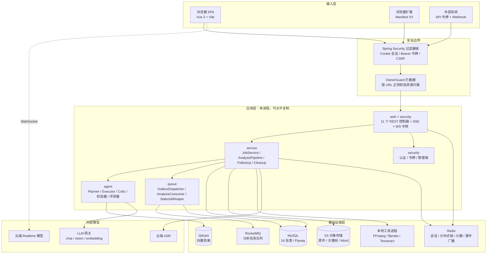
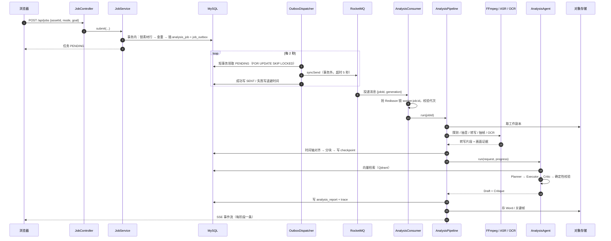
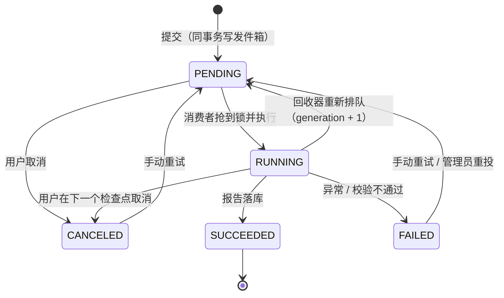
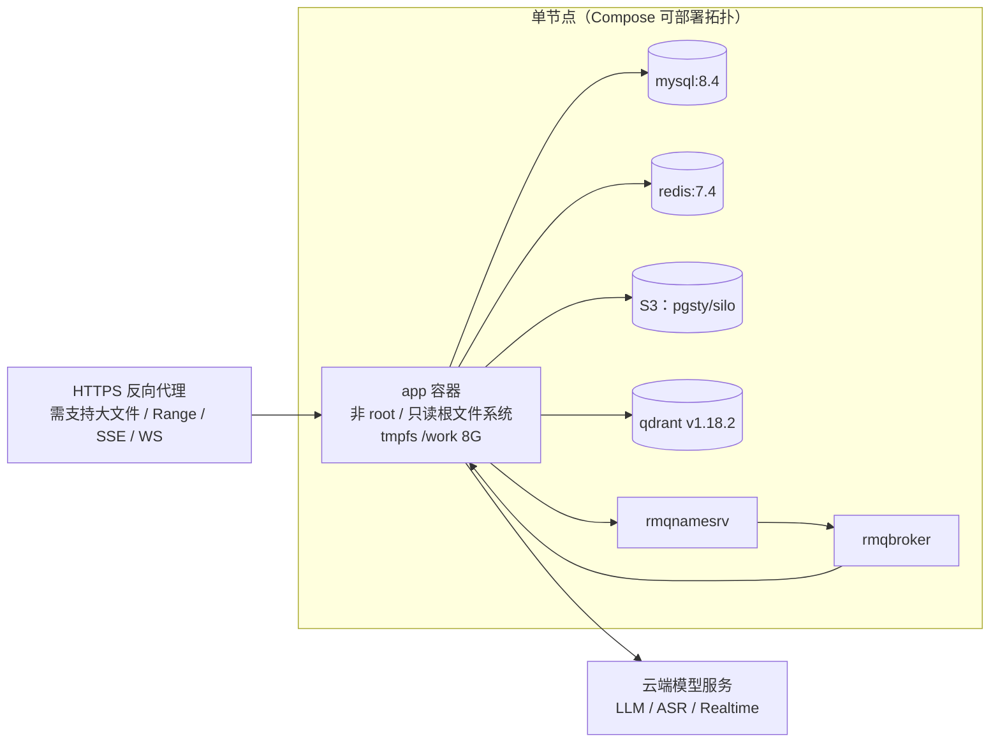
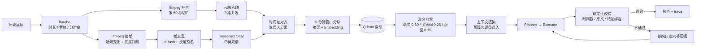
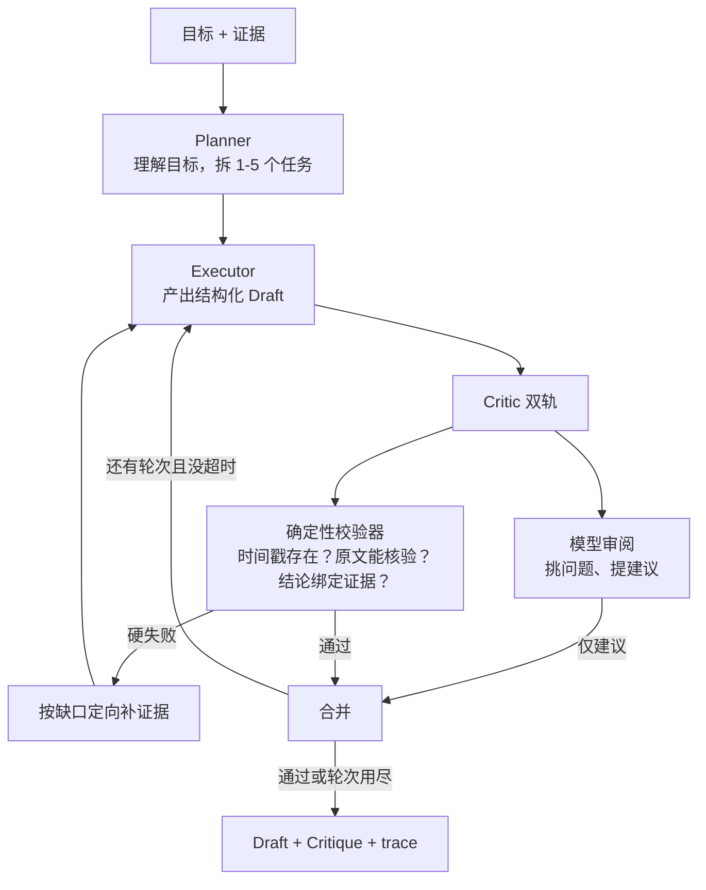
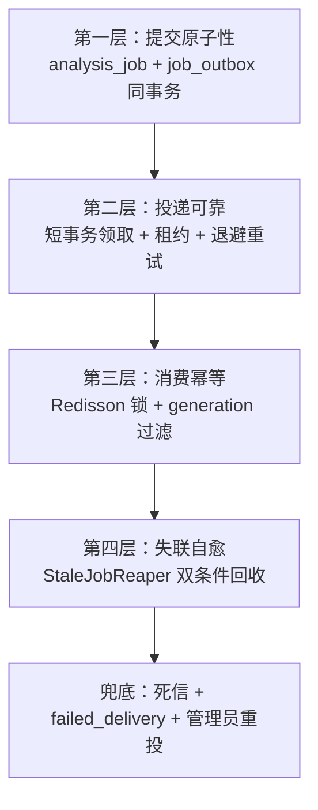

# 面试导读：架构、组件与功能

这份文档面向一件事：**在面试里把这个项目讲清楚**。

它不重复接口细节（那是 [api.md](api.md)），也不重复部署步骤（那是 [deployment.md](deployment.md)）。
它回答四个问题：

1. 架构是什么样，画出来是什么样；
2. 用了哪些组件，**为什么是它**，解决什么问题，代价是什么；
3. 有哪些功能，每个功能的亮点和技术点是什么；
4. 被追问时怎么答，哪里会翻车。

想「吃透」整个项目而不只是应付面试，先读 [deep-dive.md](deep-dive.md)；这份文档是它的面试浓缩版，
并且把**组件选型的横向对比**补充完整——那部分是面试官最爱挖的。

---

## 0. 怎么用这份文档

| 场景 | 读哪几节 | 时间 |
|---|---|---|
| 面试前 30 分钟 | §1 一页纸 → §6 数字速查 → §7 追问与雷区 | 30 分钟 |
| 面试前 2 小时 | 再加 §2 架构图、§3 组件选型、§4 功能清单 | 2 小时 |
| 被问到某个具体技术 | §3 对应小节（每个组件都有「替代方案 / 代价 / 追问」三栏） | 5 分钟 |
| 想改代码或写简历项目描述 | 全读，再看 [deep-dive.md](deep-dive.md) §7 代码地图 | 半天 |

**一条原则**：面试里讲技术选型，永远按「问题 → 候选方案 → 为什么选它 → 付出了什么代价」四步讲。
只讲「我用了 RocketMQ」是背书；讲「我为什么不用 Kafka、为什么还要在它前面加一层发件箱」才是设计。

---

## 1. 一页纸

### 1.1 三十秒版本

> 这是一个长视频/长音频分析系统：把几十分钟的视频变成一份**每条结论都能点回原片时间点**的结构化报告，
> 并且可以基于这些证据继续追问。
> 后端 Java 21 + Spring Boot，前端 Vue 3，中间件是 MySQL、Redis、RocketMQ、S3、Qdrant。
> 项目 1.28 万行 Java、51 个接口、154 个后端用例。
> 技术难点不在「调模型总结」，而在三件事：**长**（塞不进上下文）、**不可信**（模型会编时间戳）、
> **会坏**（一次分析跑十几分钟，中间任何一步都可能失败）。

### 1.2 三条设计主线

项目的所有复杂度都可以回溯到这三条：

| 主线 | 一句话 | 直接推论 |
|---|---|---|
| **证据链优先** | 先有证据，再有结论；结论必须绑定证据；证据必须能在原片核验 | 时间戳强校验、ASR 与 OCR 合并进同一上下文块、确定性校验器有否决权 |
| **长上下文靠检索** | 切块 → 建索引 → 按意图检索 → 组装成有预算的上下文 | 5 分钟窗口分块、Qdrant 混合检索、上下文预算裁剪 |
| **任务必须可恢复** | 失败要么明确失败并留原因，要么从断点继续 | 事务发件箱、代次、断点、僵尸任务回收 |

### 1.3 它明确不做什么

面试里主动说「我不做什么」，比堆功能更能体现判断力。

| 不做 | 为什么 |
|---|---|
| 不做降级兜底（无 H2 / 内存向量库 / 离线模板 / 本地 Whisper） | 兜底会让「看起来成功但不可信」的报告流出去。`config/ProductionRequirements.java` 启动时就拒绝缺 MySQL 或真实模型的配置 |
| 不做「换个措辞重试」 | 模型缺的是证据，不是措辞。第二轮补的是**证据**，不是提示词 |
| 不承诺外部模型计费「恰好一次」 | 消息是至少一次投递，进程可能在模型调用后、结果落库前退出 |
| 不做声纹识别 | 说话人分离基于音高，是近似标注，不是 biometric |
| 不用内存 pub/sub 推进度 | 事件以 `job_event` 表为准，Redis 只负责「叫醒」，丢一条最多退化成一次轮询 |

---

## 2. 架构

### 2.1 五层全景图



**这张图要能讲出的三句话**：

1. **应用层是一个进程，但有四个角色**：HTTP 服务、任务生产者、任务消费者、定时运维。
   它们共用同一份镜像，靠 RocketMQ 解耦——所以 scale out 时消费者可以单独加。
2. **MySQL 是唯一的事实来源**：任务状态、事件、报告、断点都在 MySQL。Redis 和 MQ 都是「加速器」，
   它们挂了会让系统变慢或暂停，但不会让数据不一致。
3. **二进制数据只有一个家**：S3。数据库里只有对象键，所以 API 实例和消费实例不需要共享磁盘。

### 2.2 一次分析的完整时序



### 2.3 任务状态机



两个面试要点：

- **失败是终态但不死**：`FAILED` 可以回到 `PENDING`，走的是**同一个**状态机（递增代次），
  所以「重试」不是另一条代码路径，不需要单独的幂等设计。
- **`RUNNING → PENDING` 这条自愈边**，是很多同类项目没有的。它解决的是「消费者进程死了但消息已经 ack」——
  消息不会再投递，任务永远停在 RUNNING，前端一直转圈。

### 2.4 部署拓扑



**为什么只有 app 一个服务对外**：中间件端口全部不映射到宿主机，只活在容器网络 `backend` 里。
这不是"能跑就行"的写法——面试里可以说：**攻击面收敛**是安全设计，不是部署细节。

### 2.5 证据是怎么从媒体变成报告的

这张图是「你凭什么说报告可信」的答案。



---

## 3. 组件选型手册

每个组件都按同一结构讲：**解决什么问题 → 为什么是它 → 替代方案与代价 → 面试追问**。

### 3.1 Spring Boot 3.5 + Java 21

**解决什么**：一个长任务编排系统需要的全部基础设施——依赖注入、配置绑定、Web、事务、Actuator。

**为什么是这个组合**：

- **Java 21** 的原因很具体：SSE 推送用的是 `Thread.ofVirtual().name("sse-pump-" + id)`。
  一个用户开 5 个任务页就是 5 条长连接，平台线程模型下这会吃掉 5 个 Tomcat 线程；
  虚拟线程让「每个连接一个线程」这种最简单的写法重新变得可行。
  （注意：项目**只在这里**用虚拟线程，没有全局开 `spring.threads.virtual.enabled`——
  因为剩下的瓶颈在 FFmpeg 子进程和外部 HTTP，不在线程数。）
- **Spring Boot 3.5** 而不是 2.x：`HttpSecurity` 的 lambda DSL、`HttpSessionSecurityContextRepository`
  的显式配置、Jakarta 命名空间，这些都是 3.x 才干净的。

**代价**：Spring 的启动时间和内存占用不适合 Serverless；`@ConfigurationProperties` 的默认值容易和
`application.properties` 里的显式值不一致（项目里就踩过：`AgentProperties` 的 Java 默认值是 180 秒，
而配置文件写的是 300 秒，文档一度写错）。

**追问：「为什么不用 Python？这个领域不是 Python 生态更好吗？」**
答：这个项目的 AI 部分全部是 HTTP 调用（chat / embedding / ASR），**没有一个本地推理**。
所以 Python 的生态优势用不上；反而后端的价值集中在并发编排、事务、分布式锁、连接池这些工程能力上，
Java 更合适。真正需要本地推理的地方（OCR）也是调命令行，不调 Python 库。

### 3.2 MySQL 8.4 + Spring JDBC + Flyway

**解决什么**：任务状态、事件、证据、报告的唯一事实来源；16 张表的结构演进。

**为什么不用 JPA / MyBatis**：

| 方案 | 不选的理由 |
|---|---|
| JPA / Hibernate | 这个项目的查询几乎全是「带状态条件的批量更新 + 局部字段读写」，实体图关系很弱。JPA 会带来 N+1、脏检查、延迟加载这些用不上的复杂度 |
| MyBatis | 需要额外的 XML 或注解映射文件，而这里 SQL 本身就是领域逻辑（比如发件箱的 `FOR UPDATE SKIP LOCKED` 领取语句），直接写反而更清楚 |
| Spring JDBC | 10 个 `*Repository` 类，每个都是 `JdbcTemplate` + 一个静态 `RowMapper`。SQL 全在眼前，索引有没有走到一眼能看出来 |

**为什么用 Flyway**：16 张表分了 4 个迁移文件（V1 建表、V2 用户与发件箱、V3 失败投递重放、
V4 令牌与 Webhook），对应项目的四个演进阶段。**`baseline-on-migrate=false`** 是刻意的：
不允许应用自动接管一个不是它建的库。

**代价**：没有 ORM 就没有自动的关联加载，跨表查询要手写 JOIN；也没有乐观锁注解，代次要自己维护。

**追问：「16 张表怎么分的？」**
分五组：核心四张（`media_asset` / `analysis_job` / `analysis_report` / `job_checkpoint`）、
证据三张（`transcript_segment` / `visual_evidence` / `context_chunk`）、
可靠性四张（`job_outbox` / `failed_delivery` / `job_event` / 分布式锁借用 Redis）、
上传两张（`upload_session` / `upload_chunk`）、对外开放两张（`api_token` / `webhook`），
外加 `chat_message` 和 `app_user`。

### 3.3 Redis：一个组件，四种用途

这是最容易被追问「你怎么什么都往 Redis 塞」的地方，必须能逐个说清。

| 用途 | 实现 | Key 形态 | 为什么放 Redis |
|---|---|---|---|
| 共享会话 | `spring-session-data-redis` | `video-studio:sessions:*` | 应用可以水平复制，会话不能粘在单机上 |
| 分布式锁 | Redisson `RLock`（看门狗 60 秒续期）；提交幂等锁走 `SET NX PX` + Lua 解锁 | `worker:job:{id}`、`submit:{assetId}:{digest}`、`upload:{uploadId}` | 消费互斥、重试互斥、提交与分片合并幂等，都需要「跨进程只能有一个」 |
| 计数型限流 | Lua：`INCRBY` + 首次写入时 `PEXPIRE`（固定窗口） | `rate:login:{ip}`、`rate:submit:user:{uid}` | 原子自增，天然跨实例；固定窗口是"够用且能解释"的选择 |
| 预算累计 | 同一个 Lua 计数脚本 | `video-studio:budget:job:{id}`、`...:daily:{date}`、`...:daily:user:{uid}:{date}` | 同上，且过期即自动清零 |
| 事件广播 | Pub/Sub | `video-studio:job-events` | 只广播「有新事件了」这一个信号，**不传数据** |

**五个设计细节，都是能展开讲的**：

1. **锁有看门狗，所以「锁在」等于「worker 活着」**。这是僵尸任务回收的判据基础——
   如果锁没有续期机制，就没法区分「任务卡住」和「worker 正在跑一个十分钟的模型调用」。
2. **事件广播不传数据**。Redis 丢一条消息最多退化成一次 3 秒轮询，不会丢事件——
   因为事件历史在 `job_event` 表里，SSE 断线重连时按 `seq` 回放。
3. **限流的 key 前缀带维度**（`rate:login:{ip}` / `rate:submit:user:{uid}`），
   这样限流策略可以按入口分别配置，而不是全局一个桶。
4. **预算是 token 维度，不是请求次数维度**。一次请求可能是 200 token 的分块摘要，
   也可能是 8000 token 的长上下文执行——按次数限流挡不住真正的花费。
5. **Redis 的读写只有一个入口**。所有 `StringRedisTemplate` 的读写、key 拼装、TTL、两段 Lua 脚本
   （解锁校验、计数并首次设过期）都集中在 `infra/RedisSupport.java`，其余 5 个类只用 Redisson 的
   `RLock`。所以「哪个 key 会不会忘设过期」只需要看一个文件。

**代价**：Redis 挂了，锁和限流就没了。项目的选择是——**Redisson 启动连不上直接失败**，
不降级。因为「降级成无锁」意味着两个消费者可能同时跑同一个任务，重复花模型的钱。
这是把「可用性」换「正确性」的显式取舍。

**追问：「为什么不用 Redis 做任务队列？不是更简单吗？」**
答：Redis 的 List/Stream 做队列，在「消息与数据库状态必须一致」这一点上没有原生支持。
事务发件箱的核心诉求是「任务记录和投递记录原子写入」，这要求队列能被同一个本地事务覆盖——
只有 MySQL 能做到。Redis 一旦在 `XADD` 之后崩溃，就会出现「任务在库里但没人消费」。

### 3.4 RocketMQ 5.3.4 + 事务发件箱

**解决什么**：把「提交任务」和「异步执行」解耦，同时保证**提交成功就一定会有执行者**。

**为什么不用「直接投递」**：`jobService.submit()` 里如果先写库再发消息，两步之间崩溃 →
任务永远 PENDING 没人消费。如果先发消息再写库，消费端可能查不到任务 → 消息被丢弃。

**为什么用发件箱（Transactional Outbox）**：
`analysis_job` 和 `job_outbox` 在**同一个 MySQL 事务**里写。发件箱是「要发但还没确认发出」的意图记录。
后台 `OutboxDispatcher` 每 2 秒扫一次，发出去了才标 SENT。这样：

- 事务提交 → 记录一定存在 → 一定会被投递（至少一次）；
- 事务回滚 → 记录一起没了 → 不会发出幽灵消息。

**为什么不用 RocketMQ 自己的事务消息**：它需要实现 `TransactionListener` 的回查接口，
而且回查依赖你有办法反查本地事务状态。用发件箱后这套机制是**可见、可查、可重放**的——
出问题时直接 `SELECT * FROM job_outbox` 就知道卡在哪。多一层表，换来的是完全的可观测性。

**为什么发件箱要分三段，而不是一个长事务**：

```
① 短事务：SELECT ... FOR UPDATE SKIP LOCKED LIMIT 10
          UPDATE ... SET next_attempt_at = NOW() + 60 秒   ← 租期
          COMMIT
② 事务外：逐条 syncSend，超时 5 秒
③ 短事务：成功写 SENT / 失败写退避时间
```

理由是一条实测数字：**`syncSend` 在 Broker 卡顿时会阻塞到超时（5 秒），
一次取 10 条最坏持锁 50 秒**——既挡住其它实例，也拖垮 Hikari 连接池。

**为什么用 `next_attempt_at` 当租约，而不是加一个 `SENDING` 状态**：
加了 SENDING 就得配一个「超时把 SENDING 改回 PENDING」的补偿器——多一个组件、多一条可能出错的路径。
用时间字段当租约，**租期一过记录自动重新可领**，崩溃路径免费恢复。

**踩过的坑（面试很加分）**：租期必须从 `NOW()` 起算，不能从旧值累加。
积压记录的 `next_attempt_at` 可能已经过去几分钟，`+60 秒` 仍在过去，别的实例会立刻再次领取，租约等于没生效。

**代价**：至少一次投递，不是恰好一次。所以下游必须幂等——这就是下面代次机制存在的原因。

**追问：「为什么不直接用 Kafka？」**
答：这个场景是**低吞吐、高可靠、需要延迟消息和重试计数**。RocketMQ 的
`maxReconsumeTimes=3` 和死信队列 `%DLQ%` 是开箱即用的；Kafka 要做同样的语义需要自己维护
重试 topic 和偏移量管理。而且 Kafka 的运维成本（分区、副本、ISR）在单节点部署里是纯负担。
选型的判据是「**每秒几条消息**」，不是「谁更火」。

### 3.5 S3 兼容对象存储

**解决什么**：媒体原件（单个最大 2 GiB）、关键帧（最多 400 张/任务）、Word 报告。

**为什么不用本地磁盘**：消费者可能在另一台机器上，它拿不到生产者的本地文件。
对象存储让「API 实例」和「消费实例」彻底无状态，可以直接水平扩展。

**为什么不用数据库存 BLOB**：2 GiB 的单行 BLOB 会撑爆 buffer pool，
备份和主从复制的成本会随视频数量线性爆炸。

**Key 的设计**（`storage/MediaObjects.java`）：

```
assets/{assetId}/source{ext}                    原始媒体
assets/{assetId}/frames/job-{jobId}/...         关键帧（按任务隔离）
assets/{assetId}/report/report-{jobId}.docx     Word 报告
uploads/{uploadId}/{index}                      分片上传的临时块
```

按 `assetId` 分组、按 `jobId` 隔离，意味着**删一个任务只要删一个前缀**，删一个素材只要删一棵树。

**追问：「为什么本地还要有 `/work`？」**
答：FFmpeg 和 Tesseract 需要文件路径，不能直接吃对象流。`WORK_ROOT` 是**工作副本**，
不是存储。容器里它是 tmpfs（重启即失），并且有 `WorkFileJanitor` 定期回收
「超过 24 小时且没有活动任务」的目录。

### 3.6 Qdrant + 混合检索

**解决什么**：两小时的视频切成 24 个上下文块，模型一次只能看 3 个，得选对。

**为什么是 Qdrant，不是 Milvus / Elasticsearch / pgvector**：

| 候选 | 判断 |
|---|---|
| Milvus | 功能最全，但单机版也要 etcd + MinIO + 多个服务，运维面远大于收益。这个项目的数据量是「每个任务几十个向量」 |
| Elasticsearch | 能做向量 + 全文，但内存开销大，且我们已经有 MySQL 做事实来源，不想再引入一套索引一致性 |
| pgvector | 最省事（不引入新组件），但把向量检索压到主库上，会和分析任务的写压力互相干扰 |
| **Qdrant** | 单容器、HTTP API、payload filter 原生支持、`dimensions` 校验清楚。**REST 接口足够简单，可以直接用 JDK HttpClient 调**，不必引入官方 SDK |

**混合检索的权重**：`0.60 * 语义 + 0.25 * 关键词 + 0.15 * 画面文字关键词`。
语义权重最高是因为「用户问的和视频里说的用词常常不同」；关键词兜底专有名词；
画面文字单独一路，因为 PPT 里的字往往不在 ASR 里出现。

**一个必须能讲的取舍**：**禁止自动删除向量集合**。
维度不匹配时抛异常要求人工迁移（`Qdrant 向量维度不匹配，请迁移索引或更换集合；禁止自动删除现有集合`），
因为自动重建会静默丢掉所有历史任务的索引——用户看到的不是报错，而是"检索变差了"。

**两处降级粒度不同**：

- **写索引失败** → 降级（`degraded=true` 写进任务和 trace，产生 warn 事件，检索退化为纯关键词）；
- **读索引为空** → 不降级，直接失败（`Qdrant 未找到该任务的索引，请重试以重建索引`）。

区别在于：写失败时任务还能产出**可核验**的报告，只是检索质量差一点；
读为空说明索引根本没建起来，这时候"假装检索过了"会产出不可信的报告。

### 3.7 Spring Security

**解决什么**：多租户隔离。这个系统里「用户 A 不能看用户 B 的视频」是硬要求。

**为什么不用自己写拦截器**（参考项目就是自研的 `AuthInterceptor` + PBKDF2）：

| 维度 | 自研 | Spring Security |
|---|---|---|
| 密码哈希 | PBKDF2（自己选参数） | `BCryptPasswordEncoder(12)`，参数经过审计 |
| CSRF | 需要自己实现 token 生成/校验 | `CookieCsrfTokenRepository` + `CsrfTokenRequestAttributeHandler` |
| 会话固定攻击 | 容易漏 | `ChangeSessionIdAuthenticationStrategy` 登录后轮换 session id |
| 会话共享 | 自己写 Redis 序列化 | `spring-session-data-redis` 一行配置 |
| 过滤器顺序 | 自己保证 | 显式 `addFilterBefore(ApiTokenFilter, AnonymousAuthenticationFilter)` |

**三个具体的设计点**：

1. **principal 是字符串形式的用户 id，不是用户名**。
   `UserDetailsService` 用 `Long.toString(rs.getLong("id"))` 构造 `User`，
   于是 `CurrentUser.id()` 可以直接 `Long.parseLong(auth.getName())`。
   这样**会话认证和 API 令牌认证共用同一套授权逻辑**——令牌过滤器把 principal 也设成用户 id，
   后面的代码不需要区分「这次请求是谁认证的」。
2. **`OwnerGuard` 按 URL 正则拦**：`^/api/(media|jobs)/(\d+)(?:/.*)?$`。
   任何形如 `/api/jobs/{数字}/...` 的接口自动受保护，**新加接口不会忘记鉴权**。
   这是「默认安全」（secure by default）而不是「默认放行、逐个加注解」。
3. **CSRF token 用 Cookie 下发（`HttpOnly=false`），但会话 Cookie 是 HttpOnly**。
   CSRF token 必须能被 JS 读到才能放进请求头；会话 Cookie 绝不能被 JS 读到。
   两个 Cookie 的 `HttpOnly` 设置相反，这是故意的。

**登录接口里两个容易被忽略的细节**（写在 `security/AuthController.java` 的注释里）：

- **账号不存在时也跑一次 BCrypt**。`rows.isEmpty()` 时用一个固定的假哈希去 `matches`，
  否则「账号不存在」会立刻返回、「密码错」要算 12 轮 BCrypt，响应时间的差异就是一个用户名枚举通道。
- **登录成功后主动刷新 CSRF token** 并重新 `saveContext`。改密码/换会话后沿用旧 token 会让前端
  下一次写请求 403，排查起来很费时间。

**令牌为什么用 SHA-256 而不是 BCrypt**：
令牌是 32 字节 `SecureRandom` 生成的，熵足够高，**没有字典攻击面**；
而且它每个请求都要校验，BCrypt 的成本因子会拖慢每一次 API 调用。
密码不一样——密码是人选的，熵低，必须用慢哈希。

**代价**：Spring Security 的配置学习曲线陡，401 和 403 的默认行为是 HTML 重定向，
项目里专门写了 `authenticationEntryPoint` 和 `accessDeniedHandler` 返回统一 JSON。

**追问：「CSRF 现在还有必要吗？」**
答：有，因为认证靠 Cookie。如果纯 Bearer 令牌认证，CSRF 天然免疫（浏览器不会自动带上
`Authorization` 头）；但只要还有 Cookie 会话，跨站表单提交就会带上 Cookie。项目里两种都支持，
所以 CSRF 保护保留。

### 3.8 Micrometer + Prometheus + Actuator

**解决什么**：长任务系统的可观测性——「现在有多少任务在跑」「队列积压多少」「模型花了多少钱」。

**14 个自定义指标**（前缀 `videostudio_`）：

| 类型 | 指标 | 回答什么问题 |
|---|---|---|
| Gauge | `jobs_active` | 当前排队 + 运行中的任务数 |
| Gauge | `outbox_pending` | 有多少消息还没被 Broker 确认 |
| Gauge | `outbox_oldest_age_seconds` | **最老**未投递记录多大年纪——区分瞬时抖动与链路中断 |
| Gauge | `jobs_over_budget` | 有多少任务吃掉了超额预算 |
| Gauge | `failed_delivery_total` | 重试耗尽的任务数 |
| Counter | `jobs_started_total` / `jobs_finished_total` | 吞吐与成功率 |
| Counter | `llm_tokens_total` | token 花费（带 model tag） |
| Counter | `jobs_requeued_total` | 自愈次数（tag `reason=stale / gave_up`） |
| Counter | `rate_limited_total` | 限流命中（tag 是 key 的第二段维度） |
| Timer | `job_duration_seconds` / `stage_duration_seconds` | 端到端与分阶段耗时 |
| Timer | `llm_call_duration_seconds` | 模型调用延迟 |
| Summary | `evidence_count` | 每个任务产出多少条证据 |

**两个设计细节**：

- `outbox_oldest_age_seconds` 比 `outbox_pending` 更有诊断价值。
  积压 5 条但最老的是 2 秒 = 正常吞吐；积压 5 条但最老是 10 分钟 = 链路断了。
- **加 `TraceIdFilter`**：`X-Request-Id` → MDC `traceId`，日志里每条都带上。
  长任务的日志如果没有 traceId，跨阶段排查基本靠猜。

**就绪探针**：`/actuator/health/readiness` 挂了两个真实拨测——`DependencyHealthConfig`
里的 `qdrant` 打 `/readyz`、`objectStore` 真去 stat 桶。不是「进程活着就算就绪」。

### 3.9 FFmpeg / Tesseract / 云端 ASR / LLM 网关

| 组件 | 为什么本地 | 踩过的坑 |
|---|---|---|
| **FFmpeg** | 抽音、抽帧是纯计算，云端逐帧处理成本高且延迟大 | `showinfo` 打在 **stderr**，只挂 stdout 会静默丢时间戳，退化成按序号推算 |
| **ffprobe** | 探测时长/音轨/分辨率，决定要不要走语音分支 | 纯音频文件没有视频流，不能假设一定有画面 |
| **Tesseract** | OCR 按帧计费的模式下，本地跑几百帧成本可控 | 中文语言包要单独装；字体缺失会让排版类截图识别率骤降 |
| **云端 ASR** | 本地 Whisper 需要 GPU，且中文长音频准确率不如云端 | DashScope 的 compatible-mode **没有** `/audio/transcriptions`（实测 404），语音模型只暴露在 chat 接口上——所以 `CloudSpeechRecognizer` 支持两种请求形态 |
| **LLM 网关** | 只走 OpenAI 兼容协议，所以能换任意兼容服务 | `max_tokens` 给 2200 时会被截断成半个 JSON，表现为「模型未返回有效产物」——一个纯配额问题伪装成模型故障 |

**LLM 网关的三个实现细节**：

1. **重试只针对 429 和 5xx**。4xx（除 429）不重试——参数错误重试一百次还是错。
2. **token 计数三级兜底**：`usage.total_tokens` → `prompt + completion` → **请求体字节数 + 响应体字节数估算**。
   第三级是因为有些网关不返回 usage，而没有计数就没法做预算控制。
3. **超时和重试次数必须为正数**，`ProductionRequirements` 启动时校验——否则第一次调用才会暴露问题。

### 3.10 Vue 3 + Vite

**解决什么**：单页应用，五个标签页（报告 / 追问 / 转写与画面 / 执行日志 / 实时对话）。

**为什么不用 React**：项目只有一个人维护，Vue 的 SFC + 响应式在这个规模下代码量更小。
`App.vue` 1,018 行确实偏大，但拆成五个标签页组件 + 一个壳之后，
真正的问题是「状态都挂在根组件」——这是已知的技术债，写在这里比藏着好。

**两个安全细节**：

- **Markdown 渲染用 `marked` + `DOMPurify`**。模型输出直接 `v-html` 是 XSS 的经典入口，
  所以先 sanitize 再渲染。Playwright 用例里专门有一条验证 XSS 清理。
- **上传分片用 `XHR` 而不是 `fetch`**，因为只有 `XHR` 有 `upload.onprogress`。
  32 MB 以上走分片（`CHUNK_THRESHOLD = 32 * 1024 * 1024`），单片的实际大小是 8 MB（服务端配置）。

### 3.11 刻意没有引入的东西

面试里被问「为什么不用 X」时，这张表就是答案。

| 没引入 | 理由 |
|---|---|
| Lombok | 记录类型用 `record`，22 行能说清。Lombok 让「这个字段哪来的」变成 IDE 才知道的事 |
| MyBatis / JPA | 见 §3.2 |
| Kafka | 见 §3.4 |
| Milvus | 见 §3.6 |
| OkHttp | `common/Http.java` 只用 JDK 的 `java.net.http.HttpClient`。为一个 POST 引入 HTTP 客户端不值得 |
| springdoc / Swagger | 51 个接口用一份手写的 90 行 `api.md` 就说清了。自动生成文档在参数是 `record` 时噪音大于收益 |
| 本地 Whisper | 需要 GPU，且中文长音频质量不如云端 |
| 前端状态管理库 | 单页应用，一个根组件 + props 够用。引入 Pinia 是为了解决"跨页面共享"的问题，这里没有 |

---

## 4. 功能清单与亮点

每个功能：**做什么 → 亮点 → 技术点 → 代码在哪 → 可能被追问什么**。

### 4.1 素材管理

- **做什么**：上传（≤2 GiB）、分片上传、链接导入、列表、删除、流式播放、缩略图、抽帧预览。
- **亮点**：
  - **分片上传的「秒传」是幂等的，不是内容去重**。同一个 `uploadId` 重复 `init`（浏览器刷新后重试）
    不会重置已上传的分片，客户端拿到 `receivedIndexes` 后跳过这些片。
  - **合并成功后才搬进正式目录**。用户中途放弃，留下的只是一堆可回收的临时分片，
    不会污染素材库。
  - **视频流支持 Range**，所以能拖进度条。不用静态资源映射的原因：素材路径由数据库记录，
    且要能返回「记录不存在」和「文件被手工删了」两种可读错误。
- **技术点**：`UploadController`（6 个接口）、`ChunkedUploadService`（分片锁 + 幂等）、
  `MediaStreamController`（206 Partial Content + `Content-Range`）、`UploadJanitor`（回收过期会话）。
- **追问**：「分片大小谁定？」服务端定（8 MB，最小 256 KB），客户端从 `/api/uploads/policy` 读——
  不能让客户端决定，否则有人传 1 字节的分片把存储打爆。

### 4.2 长音频 / 长视频转写

- **做什么**：把任意长度的音轨切成 60 秒片段，并发调云端 ASR，按顺序拼回时间轴。
- **亮点**：

  - **切片并发 + 有序收集**。3 路并发（`ASR_CONCURRENCY`），但结果按切片序号收集后排序，
    所以并发不会打乱时间轴。
  - **双请求形态自适应**。按配置的 URL 自动选 `/audio/transcriptions`（multipart）
    或 `/chat/completions`（base64 `input_audio`）。原因是 DashScope 的 compatible-mode
    没有前者——项目最初只实现了前者，配置成 DashScope 时换任何模型都失败。
  - **纯音频文件也能走**。没有视频流时跳过抽帧，不报错。
- **技术点**：`AudioExtractor`（一次 `ffmpeg -f segment -segment_time 60 -reset_timestamps 1 -segment_list csv` 出完所有切片）、
  `TranscriptionService`（线程池 `asr-N`）、`CloudSpeechRecognizer`（两种形态）。
- **追问**：「切片边界会切断词怎么办？」会在，所以切片不重叠，但相邻片段在时间轴上连续，
  上下文渲染时同一窗口内的片段会被合并成一段连续文本，切断的影响被削弱。

### 4.3 关键帧抽取与去重

- **做什么**：从视频里挑出「画面变了」的帧，交给 OCR。
- **亮点（这块的坑最多，也最能体现工程能力）**：

  - **不是按固定间隔抽**，而是 ffmpeg 的 `select` 滤镜组合两个条件：
    场景变化（`gt(scene, 0.006)`）**或** 距上次选帧超过 20 秒（兜底）。
    纯场景检测在静态 PPT 上会一帧不出；纯固定间隔在快速剪辑上会漏关键画面。
  - **时间戳从 `showinfo` 拿，而 `showinfo` 打在 stderr**。
    只挂 stdout 回调会**静默**丢掉所有时间戳，然后退化成按序号推算——报告里的时间点会全错，
    但表面上看不出来。
  - **两级去重**。dHash（汉明距离 ≤5）+ 24×14 灰度签名（平均绝对差 ≤1.2）。
    为什么两级：纯 dHash 在「整屏深色 + 中间一行标题」的幻灯片上会失效——
    8×8 网格下所有帧算出同一个值。灰度签名补的是「亮度分布」这个维度。
  - **OCR 之后还有文本判重**。归并空白后与上一张保留帧相同就丢弃，
    解决「同一页 PPT 停留 3 分钟，场景检测只给一帧，但过渡动画给了五帧」。
  - **上限 400 帧**（`-frames:v 400`）。两小时的视频不加限制能抽出几千帧，OCR 会跑到天亮。
- **技术点**：`FrameExtractor`（滤镜 + stderr 解析 `pts_time`）、`FrameDeduper`、`VisualEvidenceService`。
- **追问**：「0.006 这个阈值怎么来的？」ffmpeg 的 `scene` 分数是归一化的，
  0.006 对「PPT 翻页」这种低对比变化敏感，又不会对压缩噪声误触发。更关键的是——
  **这个值过去被 `"%.2f"` 格式化成了 0.01**，改回来之后抽帧数量才对。

### 4.4 画面文字识别

- **做什么**：对去重后的关键帧跑 Tesseract，产出「时间点 + 文字」的证据。
- **亮点**：
  - **串行算指纹 → 并行 OCR → 串行文本判重**。指纹必须串行（要和上一帧比），
    OCR 是 CPU 密集可以并行（3 路），文本判重又必须串行（要按时间顺序比对）。
  - **可选视觉描述**。`visionCaptionEnabled` 默认**关闭**，因为视觉模型按帧计费，
    长视频几百帧全量调用成本不可控。打开后**只补 OCR 一个字都没读到的帧**（`captionBlankFrames`），
    且单任务上限 24 帧，超出只描述最早的一批。描述结果和 OCR 文字走同一个证据结构，
    `captionOnly` 的条目单独计数写进 trace。
  - **识别失败不阻断**。单帧 OCR 失败记录空串，不抛异常——一帧识别不出来不该让整个任务失败。
- **技术点**：`CommandTextRecognizer`（调本地命令）、`VisualEvidenceService`（编排 + 判重）、
  `FrameCaptioner`（视觉描述，默认关）。

### 4.5 说话人分离

- **做什么**：把相邻的转写片段标注成「讲者A / 讲者B」。
- **亮点（这是整个项目最"轻"也最有解释力的一个设计）**：

  - **用基频（F0）中位数，不用声纹嵌入**。声纹模型（ECAPA、Resemblyzer）要几千万参数和一次前向推理，
    为了一个"谁在说话"的标注再塞一个模型运行时，性价比太低。
  - **三个具体取舍**：
    - **用半音不用赫兹**。赫兹是对数感知的，440→880 的差异听起来是一个八度，
      但数字上是两倍；半音才是听感上的等距。
    - **用中位数不用均值**。一帧噪声、一声咳嗽就能把均值拉偏。
    - **只有一个说话人时不打标签**。硬标"讲者A"会让下游误以为做了分离。
  - **倍频错误阈值 6 个半音**（三全音）。F0 检测最容易犯的错是把基频认成两倍，
    正好差一个八度；6 个半音以内认为是同一个人的音高波动。
  - **代价写在明处**：同性别、音高接近的两个人分不开。这是近似标注，不是 biometric。
- **技术点**：`SpeakerDiarizer`（25 ms 帧长、每段上限 240 帧、一维层次聚类）、
  `WavAudio`（手写 RIFF 解析，不用 `AudioSystem`——后者在有大量切片时会泄漏文件句柄）。

### 4.6 时间轴对齐与分块索引

- **做什么**：把转写和画面证据对齐到同一时间轴，再按 5 分钟窗口聚合成「上下文块」。
- **亮点**：
  - **5 分钟窗口是刻意的折中**：比句子大，能承载一整个话题；比整片小，能精确引用时间戳。
  - **分块时同步生成摘要和 Embedding**。摘要用于上下文渲染（省 token），
    Embedding 用于检索（语义匹配）。
  - **块内同时保留 ASR 片段和该窗口内的 OCR/VISION**，这是后面「证据链」的基础。
- **技术点**：`ChunkBuilder`、`ChunkEnricher`（摘要 `max_tokens=260`、`temperature=0.2`）。

### 4.7 混合检索

- **做什么**：给定一个问题或分析目标，从所有块里选出最相关的 3 个。
- **亮点**：
  - **三路打分加权**：语义 0.60 / 关键词 0.25 / 画面文字关键词 0.15。
  - **检索规划（retrieval planning）**：不是拿用户原话去搜，而是先让模型产出一个
    `RetrievalIntent { semanticQuery, keywords, visualKeywords }`——
    把「我想知道这个视频讲了什么架构」翻译成「semanticQuery: DeepSeek Super Agent 架构」+
    「keywords: Router, Worker」+「visualKeywords: 架构图, 流程图」。
  - **语义检索失败自动退化为关键词**。`semanticScores` 包了 try-catch，
    异常时返回空 map，权重自然落到关键词上——**降级是静默的、局部的、可观测的**
    （写了 warn 日志和事件）。
- **技术点**：`HybridRetriever`、`QdrantVectorStore`、`ModeRouter` 的姊妹类 `planRetrieval`。

### 4.8 Agent 编排：Planner / Executor / Critic

- **做什么**：把「检索到的证据」变成「结构化的报告草稿」，并且反复检查它有没有编。



- **亮点（这是整个项目最核心的设计）**：

  - **模型批评没有否决权，确定性校验器有**。注释原文：
    「模型批评只作为『还值不值得改一轮』的信号，不决定任务成败。实跑经验：它每轮都能挑出新的措辞问题，
    把它当否决权会让正确报告永远出不来。」
  - **硬失败只有四类**：缺必需小节、存在空结论、证据来源不合法、**全部证据都无法核验**。
    其余（某个时间戳对不上、某条结论没绑定证据）只记 `problems`，不否决。
    理由是：**部分失败是正常的**，一份报告里 20 条结论有 2 条证据弱，不该整份扔掉。
  - **第二轮补的是证据，不是提示词**。Critique 返回 `missingRequirements` 和
    `unsupportedClaims`，`recallByCritique` 把这些变成定向检索，把缺失时间点的原始片段重新加载进来。
  - **有轮次上限（2）和墙钟上限（300 秒）**。Agent 循环没有上限 = 账单没有上限。
  - **模型 Critique 解析失败就当作通过**。Critic 只是建议角色，它自己坏了不应该拖垮任务。
- **技术点**：`AnalysisAgent`（`run` / `execute` / `critique` / `recallByCritique`）、
  `EvidenceValidator`（五类检查 + 硬失败白名单）、`ContextRenderer`（预算裁剪 + 按时间戳召回）。
- **追问**：「怎么证明这个 Agent 比单次 prompt 好？」
  答：`DraftEvaluator` 给确定性评分（0.10 时间戳覆盖 + 0.45 证据支持 + 0.30 结论支持 + 0.15 关键词覆盖），
  写进 trace。**它不设阈值、不做否决**——评分只回答「比上次好还是差」，
  要不要发布由校验器决定。把两者混在一起会让「调提示词」变成「猜阈值」。
  （诚实补充：项目目前**没有** golden case 批量回归，这是与参考项目的主要差距之一。）

### 4.9 报告生成与导出

- **做什么**：Markdown 报告 + Word 文档（带关键帧插图）+ 三种字幕格式（SRT / VTT / TXT）。
- **亮点**：
  - **Word 里的图片不进 Markdown**。Markdown 里写本地绝对路径会让浏览器去请求 `file://`，
    所以图片走旁路：`record Figure(timeMs, Path image, String caption)` 单独传给导出器，
    只在 Word 的「视频证据」小节之后落到文档里。
  - **字幕格式必须严格**。SRT 序号从 1 开始、时间轴用逗号；VTT 用句点且首行固定 `WEBVTT`。
    相邻片段留 20 ms 空隙，否则渲染引擎会判为重叠、画面闪一下。
  - **报告头部带元信息表**：分析目标、分析模式、媒体时长、证据校验结论、生成方式。
    这份表让报告能自证——「这份报告是用什么模式、什么引擎生成的」。
- **技术点**：`ReportComposer`、`DocxExporter`（POI，`FIGURE_WIDTH=420`）、`SubtitleWriter`。

### 4.10 报告追问

- **做什么**：基于已生成的报告和证据，继续问问题。
- **亮点**：
  - **先读历史再落库**。如果先存当前问题再读历史，当前问题会在上下文里出现两次。
  - **历史只带最近 8 条**。追问是对话，不是档案。
  - **上下文复用同一套检索和渲染**。追问和主分析用的是同一个 `HybridRetriever` 和 `ContextRenderer`，
    所以「追问能引用的证据」和「报告引用的证据」是同一批。
  - **回答必须带时间戳引用**，`Times.extractCitations` 会把它们抽出来存进 `citations_json`，
    前端可以做成可点击的跳转。
- **技术点**：`FollowUpService`、`prompts/follow-up.md`（400 字上限、证据不足要明说）。

### 4.11 实时对话（WebSocket 中转）

- **做什么**：浏览器直接把摄像头/麦克风接给云端 realtime 模型，做实时对话。
- **亮点**：
  - **为什么要中转**：浏览器的 WebSocket API **不能自定义 `Authorization` 头**，
    而云端 realtime 接口要求 Bearer 鉴权。所以由服务端建上游连接、转发帧。
  - **不解析、不存储**。只做二进制/文本帧的双向转发，隐私边界清晰。
  - **未配置时明确关闭**，`session.close(SERVICE_OVERLOAD.withReason("云端实时模型未配置"))`。
- **已知短板（主动说）**：`/ws/realtime` 目前在 `WebSocketConfig` 里是裸 `addHandler`，
  **没有接限流和来源校验**（`rate.realtime-per-minute=30` 配置了但零引用）。
  这是明确的待办，不是没意识到。

### 4.12 任务可靠性：四层防线

这是整个项目最"后端"的部分，也是面试最容易深挖的。



| 层 | 防的是什么 | 关键实现 | 一个细节 |
|---|---|---|---|
| 1 提交 | 任务写进去了但没投递 | 同一事务写 `analysis_job` + `job_outbox` | Redis 锁在事务**外**，避免锁持有时间被事务拖长 |
| 2 投递 | 发送失败 / 进程崩溃 | 三段式 + `next_attempt_at` 当租约 + 指数退避（上限 300 秒） | 租期从 `NOW()` 起算 |
| 3 消费 | 重复投递导致重复花钱 | 客户端抢锁，抢不到**直接 ack 不抛错**；代次不符直接 return | 抛错会消耗重投次数，长任务的重复投递能把消息推进死信 |
| 4 自愈 | 进程死了，消息已 ack | 「15 分钟无心跳 **且** 锁无人持有」双条件 + `tryLock(0)` | 直接抢锁而不是先 `isLocked()` 再改库——抢占成功本身就等价于「此刻没有 worker」 |

**「至少一次」这件事要主动承认**：
进程可能在「模型调用完成」之后、「结果落库」之前退出，恢复时会重复调用模型。
这不能承诺恰好一次计费——只能承诺**数据不重复**（`ReportRepository.insert` 先
`DELETE FROM analysis_report WHERE job_id = ?` 再插）。

### 4.13 多租户与成本控制

- **做什么**：每个用户只看自己的素材和任务；模型花费有三层上限。
- **亮点**：
  - **归属校验在拦截器里**，不在每个 Controller 里。新增接口自动受保护。
  - **三层预算**：单任务 200 万 token、全站每日 2000 万、**单用户每日 500 万**。
    第三层是后加的——原本只有一个全站键，单个用户跑几部长视频就能把当天额度吃光，
    之后所有人都提交不了任务。注释写得很直接：
    「这是把『成本控制』变成了『一个人拖垮所有人』」。
  - **消费线程没有 SecurityContext**，所以 owner 过滤不能塞进 `listByAsset`——
    否则后台任务会抛 401。拆成 `listByAsset` / `listByAssetForOwner` 两个方法。
- **技术点**：`OwnerGuard`、`BudgetGuard`、`RateLimiter`、`CurrentUser`、`JobOwners`。

### 4.14 对外开放：API 令牌与 Webhook

- **做什么**：外部系统不用浏览器会话，用 Bearer 令牌调同一套接口；任务到达终态时回调。
- **亮点**：
  - **令牌只存 SHA-256 摘要**，明文只在创建时返回一次。
  - **Webhook 带 HMAC 签名**：`X-VS-Signature: t=<ts>,v1=<hmac>`，签名内容是 `t + "." + body`，
    接收方要校验时间戳防重放。
  - **只投递一次，失败不重试**。这是显式的取舍——需要可靠送达就轮询任务接口，
    不是靠回调。写进文档比假装可靠更好。
- **技术点**：`ApiTokenFilter`、`ApiTokenService`、`WebhookService`（线程池 2、超时 10 秒、禁止重定向）、
  `IntegrationController`。

---

## 5. 关键决策速查（ADR 风格）

面试里被问「为什么这么设计」，先给这张表里的一行，再展开。

| # | 决策 | 备选 | 为什么 | 代价 |
|---|---|---|---|---|
| 1 | 事务发件箱 | 直接发 MQ / RocketMQ 事务消息 | 消息与状态原子；机制可见可查可重放 | 多一张表、多一个轮询器 |
| 2 | 发件箱三段式 | 一个长事务发完 | 10 条 × 5 秒超时 = 最坏持锁 50 秒 | 需要处理「领取后崩溃」 |
| 3 | `next_attempt_at` 当租约 | 新增 SENDING 状态 | 崩溃路径自动恢复，不需要补偿器 | 语义隐晦，要注释 |
| 4 | generation 代次 | 消息 ID 去重 | 重试复用同一任务 ID，靠代次区分新旧 | 每次重试都要 +1 并透传 |
| 5 | 确定性校验器否决 | 模型 Critic 否决 | 模型每轮都能挑出新问题，正确报告永远出不来 | 需要自己实现五类校验 |
| 6 | 硬失败只四类 | 任何问题都失败 | 部分失败是常态，不该整份扔掉 | 质量下限依赖校验器写得对 |
| 7 | 无降级兜底 | H2 / 内存向量库 / 离线模板 | 兜底会让不可信的报告流出去 | 本地开发必须起全套中间件 |
| 8 | 向量集合禁止自动重建 | 维度不匹配就重建 | 自动重建会静默丢历史索引 | 换模型要人工迁移 |
| 9 | principal = 用户 id | principal = 用户名 | 会话和令牌共用一套授权逻辑 | 用户改名不影响，但可读性差 |
| 10 | OwnerGuard 按 URL 正则 | 每个接口加注解 | 新增接口默认安全 | 正则之外的路径不受保护 |
| 11 | token 维度预算 | 按请求次数 | 一次请求可能是 200 也可能是 8000 token | 需要准确的 usage 计数（有三级兜底） |
| 12 | 5 分钟分块 | 按句子 / 按整片 | 能承载话题，又能精确引用 | 长话题会被切断 |

---

## 6. 数字速查（面试报数用）

| 项 | 数字 |
|---|---|
| 后端 | 124 个 Java 文件、**12,806 行**、19 个子包 |
| 前端 | `client/src` **4,966 行**，`App.vue` 1,018 行 |
| 接口 | **51 个** REST 映射（另加 Spring Security 提供的 logout） |
| 数据库 | **16 张表**，4 个 Flyway 迁移 |
| 后端测试 | **28 个测试类、154 个用例**（2 个 Testcontainers 用例在无 Docker 时跳过） |
| 前端测试 | **21 个单测 + 3 个 Playwright 用例**；扩展另有 7 条 `node --test` |
| 指标 | **14 个**自定义 `videostudio_*` |
| 流水线阶段 | **15 个状态**（12 个执行阶段 + 排队/完成/失败） |
| 依赖版本 | Java 21、Spring Boot 3.5.16、RocketMQ starter 2.3.0、Redisson 3.52.0、MinIO 8.5.17、POI 5.4.1、Qdrant v1.18.2、MySQL 8.4、Redis 7.4 |
| 关键阈值 | 发件箱 2 秒轮询、租期 60 秒、批量 10、发送超时 5 秒、退避上限 300 秒、自愈 15 分钟、自动重跑上限 3 次、消费重试 3 次、Agent 2 轮 / 300 秒、抽帧上限 400、分片 8 MB、上传上限 2 GiB |

---

## 7. 高频追问与雷区

### 7.1 一定要能答的五个追问

**Q：你这个项目和「调个模型总结视频」有什么本质区别？**
> 区别在**证据链**。普通总结是「模型说视频讲了 A」，我们的报告是「模型说视频讲了 A，
> 依据是 [02:00] 的这句原话，而这句原话在转写表里能查到、时间戳在视频里存在」。
> 每条结论都必须绑定一条能核验的证据，校验器会拒绝没有证据的结论。

**Q：模型编了一个时间戳怎么办？**
> 三道拦截。① 提示词要求「时间戳必须逐字复制，不要写 900/1000 这类看起来合理的数字」；
> ② 校验器检查该时间戳是否真的存在于转写或画面证据里；③ 检查 `content` 能否在该时间点的原文里逐字找到。
> 前两道是提示和检查，第三道是硬核验。

**Q：长视频塞不进上下文怎么办？**
> 切块 + 检索 + 预算。5 分钟一个块，每块有摘要和向量；检索时三路加权选 3 个块；
> 渲染时按字符预算逐条选入（超预算的跳过而不是截断，让后面的短块还有机会进来）；
> 上下文里 ASR 片段和它窗口内的 OCR 合并成同一段，避免模型把某帧的字挂到整分钟的时间点上。

**Q：任务跑一半进程挂了？**
> 三种情况分别处理。① 消息还没发出去 → 发件箱记录还在，租期过后重新投递；
> ② 消息发了但消费者没抢到锁 → 直接 ack，靠代次过滤；
> ③ 消费者抢到锁然后死了 → 消息已 ack，任务停在 RUNNING；
> `StaleJobReaper` 每 60 秒扫「15 分钟没更新 **且** 锁没人持有」的任务，抢锁成功后重新排队，
> 从断点继续（转写和抽帧不会重跑）。

**Q：怎么保证不重复花钱？**
> 部分保证，且要说清边界。数据层面不会重复：报告插入前先删旧记录。
> 但**外部模型调用可能重复**——进程在模型返回后、结果落库前退出，恢复时会再调一次。
> 这是至少一次投递的固有代价，不承诺恰好一次计费。缓解手段是代次 + 锁 + 预算上限。

### 7.2 主动说的三个短板

面试官更信「知道自己哪里不行」的人。

| 短板 | 现状 | 打算怎么补 |
|---|---|---|
| 没有 golden case 批量回归 | `DraftEvaluator` 只在单任务跑完时算一次分，没有「固定素材 + 固定期望」的离线跑批 | 加 `OfflineAgentEvaluationRunner`，预置 context 不调 ASR/OCR，零成本可复现 |
| 没有用户反馈回路 | 有确定性评分，没有「用户觉得这份报告好不好」的对照数据 | 加评分接口 + 把反馈变成新目标重跑 |
| `/ws/realtime` 无限流 | `rate.realtime-per-minute=30` 配了但零引用 | 在 WebSocket 握手拦截器里接限流 |

另外两个诚实的遗留：`job_event` 表没有保留策略（会一直长）、没有业务审计日志。

### 7.3 会被问倒的问题（提前准备）

| 问题 | 怎么答 |
|---|---|
| 「你的检索效果怎么评估？」 | 诚实说：目前只有 `DraftEvaluator` 的下游指标（证据支持率），没有独立的召回率评测。这是下一步要补的 |
| 「为什么单用户 500 万 token？」 | 约为全站额度的四分之一：够一个人跑完一整批分析，又不至于一个人吃光当天额度。这个数是拍的，但拍得有依据 |
| 「Agent 两轮够吗？」 | 不够就调 `agent.max-rounds`，但每加一轮就是一次全量上下文调用。当前 2 轮是成本与质量的折中，而且有 300 秒墙钟兜底 |
| 「说话人分离准确率多少？」 | 没测过 WER/DER。它是基于音高的近似标注，同性别、音高接近的两人分不开——这是写在 Javadoc 里的已知限制 |
| 「为什么不用 LangChain？」 | 这里的编排是「三个固定角色 + 确定性校验」，一共三百多行，用框架反而要学它的抽象。LangChain 的价值在工具调用链和记忆管理，这个项目两者都不需要 |

---

## 8. 三份自我介绍稿

### 8.1 三十秒（简历投递 / 自我介绍开场）

> 我做过一个长视频分析系统，把几十分钟的视频变成一份每条结论都能点回原片时间点的报告。
> 后端是 Java 21 + Spring Boot，中间件用 MySQL、Redis、RocketMQ、S3 和 Qdrant。
> 技术难点不在调模型，而在于**证据可核验**和**长任务可靠**——
> 比如用事务发件箱保证任务不丢，用确定性校验器拒绝模型编造的时间戳。

### 8.2 两分钟（技术面开场）

> 这个项目解决的问题是：视频总结本身不难，难的是三件事——视频太长塞不进上下文、
> 模型会编造看起来很像的时间戳、一次分析要跑十几分钟中间任何一步都可能失败。
>
> 架构上分三层。接入层是 Vue 单页应用加一个浏览器扩展；应用层是一个 Spring Boot 进程，
> 但它承担四个角色——HTTP 服务、任务生产者、任务消费者、定时运维，靠 RocketMQ 解耦；
> 基础设施层是 MySQL 做事实来源、Redis 做会话和锁、S3 存二进制、Qdrant 做检索。
>
> 三个我认为最值得讲的设计。第一是**事务发件箱**：任务和投递记录在同一个 MySQL 事务里写，
> 后台每 2 秒扫描发送。而且发送拆成三段——短事务领取、事务外发送、标记结果，
> 因为 `syncSend` 卡顿时会阻塞到 5 秒超时，一次取 10 条最坏持锁 50 秒。
> 第二是 **Agent 的否决权归属**：Planner/Executor/Critic 三个角色，但模型的批评**没有**否决权，
> 真正的否决权在确定性校验器手里，它只检查四类硬失败。因为模型每轮都能挑出新的措辞问题，
> 让它当否决权会让正确的报告永远出不来。
> 第三是**失联自愈**：消费者进程死了，消息已经 ack，任务会永远停在 RUNNING。
> 我加了一个每 60 秒跑的回收器，条件是「15 分钟没心跳**且**分布式锁没人持有」——
> 两个条件缺一不可，因为锁在说明 worker 还活着，只是正卡在一次十分钟的模型调用里。

### 8.3 深挖模式（对方明显感兴趣时）

按 §2 的图讲架构 → §3 挑两三个组件讲选型（建议选发件箱、Qdrant、Spring Security）→
§4.8 讲 Agent → §4.12 讲可靠性四层 → §7.2 主动说短板。

**节奏建议**：每讲完一个设计，停一下给数字（"最坏持锁 50 秒"、"154 个用例"、"14 个指标"）。
面试官记住的往往不是架构图，而是那个具体的数字。

---

## 附：这套文档怎么串

| 文档 | 回答什么 |
|---|---|
| **本文件** | 面试：架构图、组件为什么这样、功能亮点 |
| [deep-dive.md](deep-dive.md) | 吃透：每个机制的完整推导、代码位置、逐行注释解读 |
| [architecture.md](architecture.md) | 概览：请求链路、可靠性边界的一段式说明 |
| [api.md](api.md) | 接口：51 个端点的请求与响应 |
| [deployment.md](deployment.md) | 运维：Compose 拓扑、升级、死信处理、指标含义 |
| [prompts.md](prompts.md) | 提示词：九个提示词的设计意图 |
| [comparison.md](comparison.md) | 对比：与参考项目 DOVideo-AI 的逐项差异 |
| [samples/](samples/) | 实证：两份真实跑出来的报告 |
